# LabPass

LabPass is a booking application for free cloud and DevOps workshops. Users browse
workshops, reserve seats and receive confirmation emails; administrators manage
workshops and capacity. Terraform provisions the AWS infrastructure, and GitHub
Actions tests, scans and releases the application.

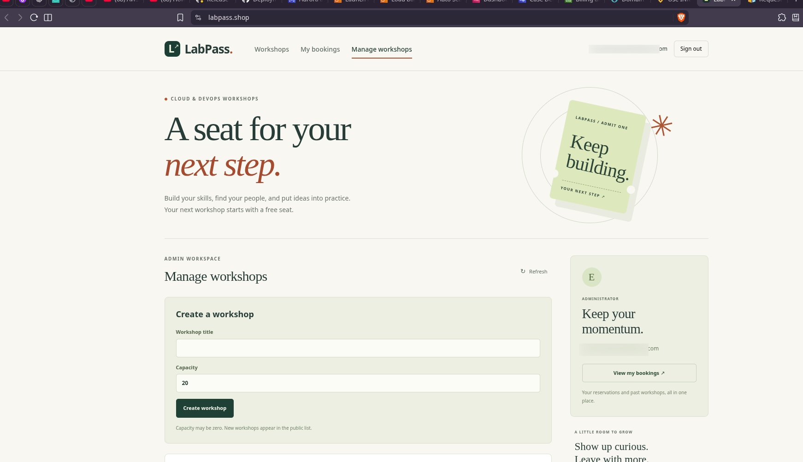

## Features

- Registration and login with password hashing and cookie sessions.
- Workshop browsing with seat availability.
- One active booking per user and workshop.
- Booking history and cancellation.
- Admin workshop creation and capacity management.
- Asynchronous confirmation emails with retries and duplicate handling.

PostgreSQL owns inventory. Booking, seat count, idempotency key and confirmation
event commit in one transaction. Concurrent requests cannot exceed capacity;
retrying a successful request with the same key returns the original booking.

## Stack

| Area | Technologies |
| --- | --- |
| Frontend | React, TypeScript, Vite |
| Backend | Python 3.14, FastAPI, SQLAlchemy, Alembic |
| Database | PostgreSQL 18 |
| Local environment | Docker Compose, ElasticMQ, Mailpit |
| Cloud workers | Amazon SQS, AWS Lambda, Amazon SES, Secrets Manager |
| Infrastructure | Terraform: Route 53, CloudFront, S3, VPC, ALB, EC2, ECR, SQS, RDS, IAM and Secrets Manager |
| Delivery | GitHub Actions, AWS OIDC, Trivy, Gitleaks, Bandit, dependency audits and SBOMs |

## AWS architecture

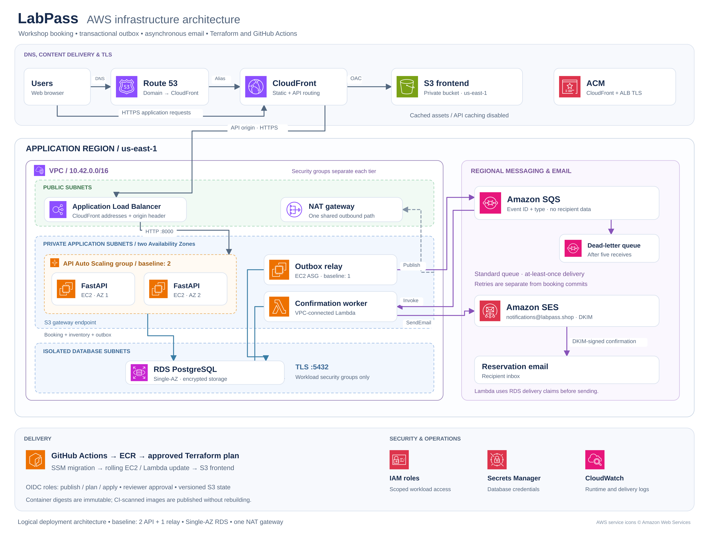

[Vector diagram](images/architecture.svg) · Service icons:
[AWS Architecture Icons](https://aws.amazon.com/architecture/icons/).

<details>
<summary>Mermaid architecture diagram</summary>

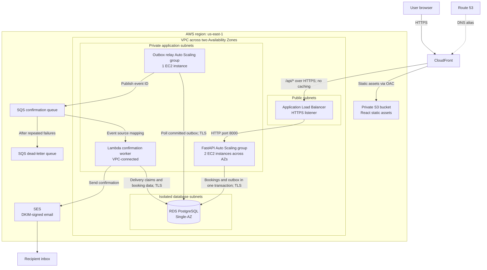

</details>

Route 53 resolves the domain to CloudFront. CloudFront serves the frontend from
private S3 through Origin Access Control (OAC) and forwards API requests to the
ALB. ACM provides certificates for the CloudFront viewer and ALB origin.
The ALB accepts CloudFront origin addresses and validates a shared origin header;
EC2 instances have no public IPs and accept API traffic only from the ALB.

The API commits each booking, inventory update and outbox event together. The
relay publishes committed events to SQS, and Lambda reads the booking and records
delivery claims before sending through SES. Queue retries and a DLQ isolate email
failures from booking transactions. SES acceptance followed by a failed database
update can still produce a duplicate email on retry.

Workloads use separate IAM roles and database credentials from Secrets Manager.
RDS connections verify TLS certificates; database security groups admit only
explicit workload groups. Systems Manager provides instance access without SSH.
Private workloads use one NAT gateway for outbound access and an S3 gateway
endpoint for S3 traffic. RDS is Single-AZ, and both application AZs share the NAT
gateway; the API's two-AZ placement does not make every dependency redundant.

Terraform composes five modules for networking, database access, application
hosting, frontend delivery and confirmations. The separate delivery root owns
GitHub OIDC access, remote state, the migration document and the public DNS zone.
See the [module interfaces](infra/modules/README.md) and
[architecture guide](docs/architecture.md) for details.

## CI/CD

CI runs backend and browser tests, checks the API contract, validates Terraform
with mocked-provider tests, audits dependencies and scans source, infrastructure
and container images. High/critical image vulnerabilities block release.

The manual release workflow runs from `dev`:

```text
Preflight → CI → Publish scanned images → Save Terraform plan → Apply and verify
```

Publish, plan and apply use separate OIDC roles and protected GitHub environments
with reviewer approval. The pipeline publishes the images already scanned by CI
to ECR, deploys by digest and verifies the saved plan's checksum and release
metadata before applying. Apply runs database migrations through SSM, updates
existing workloads, waits for rolling instance refreshes, uploads frontend assets
and checks readiness through CloudFront. Initial infrastructure provisioning is
separate from this release workflow.

Configuration and permissions: [CI/CD and release security](docs/delivery.md).

## Deployment evidence

<details>
<summary>Seat reservation and email confirmation</summary>

A reservation reduces available capacity and appears in the user's bookings.

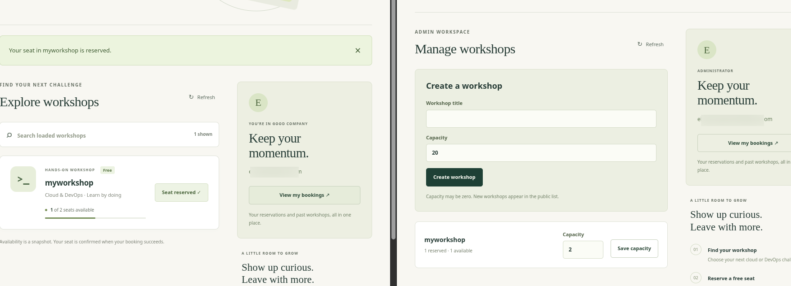

SES confirmation received from `notifications@labpass.shop`.

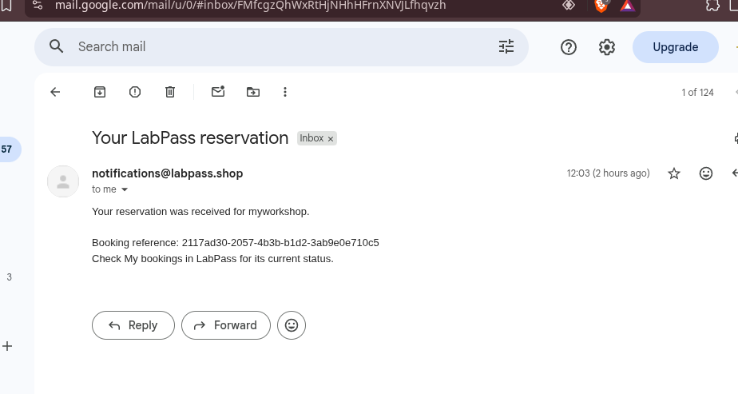

The Lambda log records `email_delivery` with outcome `sent` for the booking.

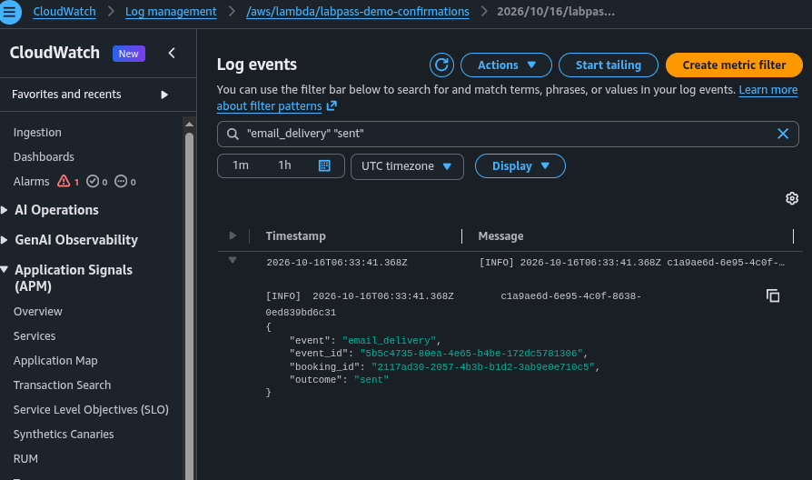

</details>

<details>
<summary>Successful CI and AWS release</summary>

CI completes the security, backend, frontend, Terraform and image checks.

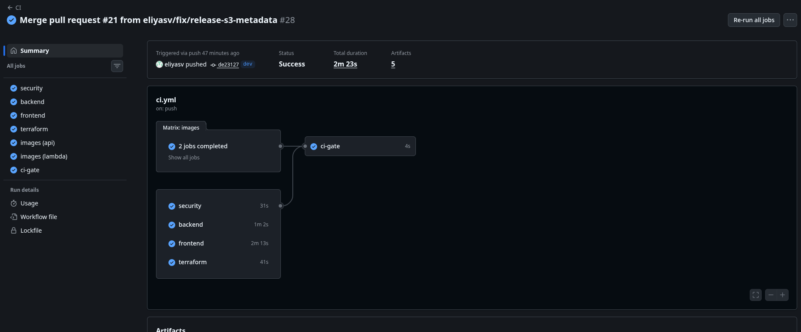

The release completes preflight, verification, image publication, plan and apply.

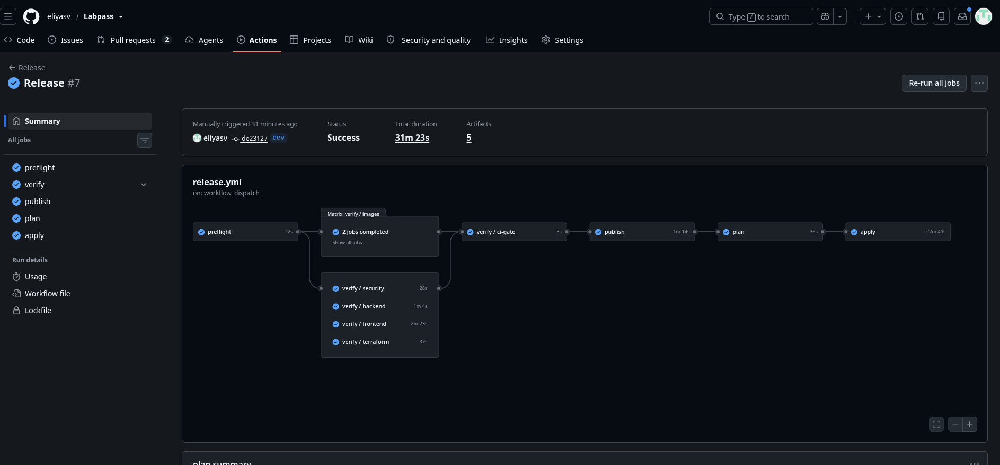

</details>

<details>
<summary>AWS networking and request routing</summary>

The VPC contains public, application and database subnets across two AZs, with a
NAT gateway and S3 gateway endpoint.

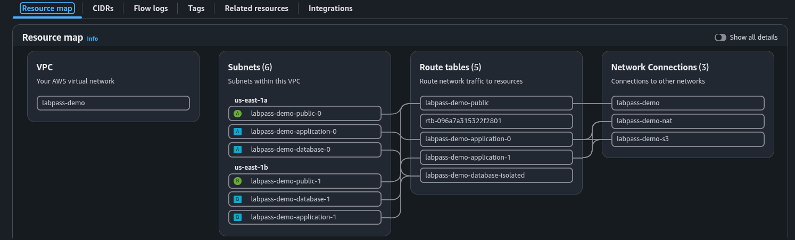

The ALB routes API requests to two healthy targets.

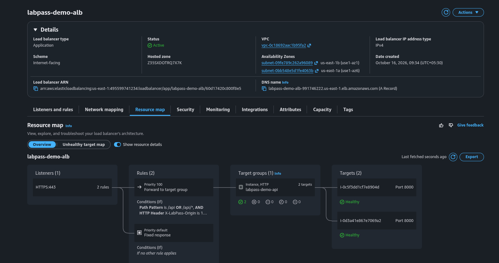

CloudFront has separate frontend and API origins; the S3 origin uses OAC.

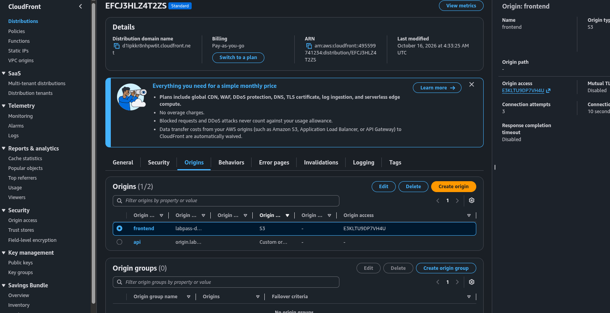

Additional views: [Auto Scaling groups](images/asg.png),
[RDS console](images/rdsconnectity.png) and
[booking cancellation](images/bookingcanceled.png).

</details>

## Run locally

Requires Docker Engine and the Docker Compose plugin. From the repository root:

```bash
[ -f .env ] || cp .env.example .env
docker compose up --build --wait --wait-timeout 120
docker compose exec api python -m labpass.seed
```

Compose starts the database, migrations, API, frontend and background workers.
The seed adds a sample workshop; create your own account in the app.

| Service | URL |
| --- | --- |
| LabPass | <http://127.0.0.1:8000/> |
| API docs | <http://127.0.0.1:8000/docs> |
| Captured emails | <http://127.0.0.1:8025/> |

Create an account, sign in and reserve a seat. Your reservation appears under
**My bookings**, where you can cancel it. Confirmation emails appear in Mailpit;
local development does not send mail to the internet.

To create an administrator:

```bash
docker compose exec api python -m labpass.create_admin --email operator@example.test
```

The command prompts for a password. Use an unused email, then sign in to access
**Manage workshops**.

Set `LABPASS_PORT` and `LABPASS_MAIL_PORT` in `.env` to change the local ports.
Stop the stack with `docker compose stop`; database, queue and mailbox data are
kept in named volumes.

## Testing

With the local stack running and the sample workshop seeded:

```bash
python3 scripts/smoke-local.py
docker compose exec -T consumer python < scripts/smoke-background.py
```

These checks exercise registration, login, booking, cancellation and confirmation
delivery, including duplicate handling.

Backend tests require Python 3.14 and PostgreSQL 18, with `initdb`, `pg_ctl` and
`createdb` on your PATH:

```bash
python3 -m venv .venv
.venv/bin/python -m pip install --require-hashes -r backend/requirements.lock -r backend/requirements-dev.lock
bash scripts/test-local.sh -q
```

The runner creates an isolated PostgreSQL cluster. The suite covers transactions,
migrations, authentication, worker failures and 100 users competing for 20 seats.
AWS responses are stubbed; database transactions use real PostgreSQL.

Frontend checks require Node.js 20.19+ in the 20.x line, or 22.12+, and the backend
dependencies installed above:

```bash
npm --prefix frontend ci
npm --prefix frontend run check-contract
npm --prefix frontend run build
```

See the [development guide](docs/development.md) for hot reload, browser tests,
API requests, worker recovery and dependency updates.

## Project structure

```text
backend/       FastAPI app, migrations, workers, tests and container images
frontend/      React app, generated API types and browser tests
local/         Local queue configuration
scripts/       Database test runner, smoke checks and OpenAPI export
infra/         Terraform delivery, networking, compute, database, queues and runtime access
compose.yaml   Local application stack
docs/          Architecture, development guides and verification reports
```

## Project status

AWS deployment and a complete GitHub Actions release have been verified, including
HTTPS routing, workshop management, reservations, cancellation and confirmation
email delivery. The screenshots above capture the deployed application and
successful pipeline runs. Traffic-driven scaling, WAF and distributed
authentication throttling are not configured. Load testing, CloudWatch alarms and
a backup restoration exercise remain outstanding. See the
[verification limits](docs/verification.md#deployment-and-operational-limits).

- [Architecture and decisions](docs/architecture.md)
- [Development and local operations](docs/development.md)
- [AWS worker configuration](docs/aws-workers.md)
- [Database runtime](docs/database-runtime.md)
- [Application hosting](docs/application-hosting.md)
- [Frontend delivery](docs/frontend-delivery.md)
- [Confirmation worker deployment](docs/confirmation-worker.md)
- [CI/CD and release security](docs/delivery.md)
- [Terraform](infra/README.md)
- [Project status](docs/checklist.md)
- [Verification evidence](docs/verification.md)
- [Technical documentation](docs/README.md)
