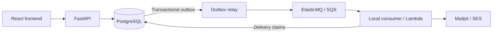

# LabPass

LabPass is a booking app for free cloud and DevOps workshops. Users can browse
workshops, reserve a seat, manage their bookings and receive confirmation emails.
Administrators manage workshops and capacity.

Built as an AWS portfolio project, it focuses on reliable booking transactions,
asynchronous processing and automated infrastructure and delivery.

## Features

- Registration and login with password hashing and cookie sessions.
- Workshop browsing with seat availability.
- One active booking per user and workshop.
- Booking history and cancellation.
- Admin workshop creation and capacity management.
- Asynchronous confirmation emails with retries and duplicate handling.

PostgreSQL owns inventory. Booking, seat count, idempotency key and confirmation
event commit in one transaction. Concurrent requests cannot exceed capacity;
retrying a successful request with the same key returns the original booking.

## Stack

| Area | Technologies |
| --- | --- |
| Frontend | React, TypeScript, Vite |
| Backend | Python 3.14, FastAPI, SQLAlchemy, Alembic |
| Database | PostgreSQL 18 |
| Local environment | Docker Compose, ElasticMQ, Mailpit |
| Cloud workers | Amazon SQS, AWS Lambda, Amazon SES, Secrets Manager |
| Infrastructure | Terraform: Route 53, CloudFront, S3, VPC, ALB, EC2, ECR, SQS, RDS, IAM and Secrets Manager |
| Planned delivery and load testing | GitHub Actions with AWS OIDC, k6 |

## Run locally

Requires Docker Engine and the Docker Compose plugin. From the repository root:

```bash
[ -f .env ] || cp .env.example .env
docker compose up --build --wait --wait-timeout 120
docker compose exec api python -m labpass.seed
```

Compose starts the database, migrations, API, frontend and background workers.
The seed adds a sample workshop; create your own account in the app.

| Service | URL |
| --- | --- |
| LabPass | <http://127.0.0.1:8000/> |
| API docs | <http://127.0.0.1:8000/docs> |
| Captured emails | <http://127.0.0.1:8025/> |

Create an account, sign in and reserve a seat. Your reservation appears under
**My bookings**, where you can cancel it. Confirmation emails appear in Mailpit;
local development does not send mail to the internet.

To create an administrator:

```bash
docker compose exec api python -m labpass.create_admin --email operator@example.test
```

The command prompts for a password. Use an unused email, then sign in to access
**Manage workshops**.

Set `LABPASS_PORT` and `LABPASS_MAIL_PORT` in `.env` to change the local ports.
Stop the stack with `docker compose stop`; database, queue and mailbox data are
kept in named volumes.

## Architecture



The relay publishes committed confirmation events to a queue. The consumer loads
the booking from PostgreSQL and uses a durable delivery claim before sending.
An email failure leaves the booking intact. An email accepted just before a
failed database update can still be duplicated on retry.

The AWS target uses Route 53 and CloudFront, private S3 frontend hosting, an ALB
with private EC2 instances across two availability zones, private RDS, SQS,
Lambda and SES. See the [architecture guide](docs/architecture.md) for the cloud
diagram, network paths and design trade-offs.

## Testing

With the local stack running and the sample workshop seeded:

```bash
python3 scripts/smoke-local.py
docker compose exec -T consumer python < scripts/smoke-background.py
```

These checks exercise registration, login, booking, cancellation and confirmation
delivery, including duplicate handling.

Backend tests require Python 3.14 and PostgreSQL 18, with `initdb`, `pg_ctl` and
`createdb` on your PATH:

```bash
python3 -m venv .venv
.venv/bin/python -m pip install -r backend/requirements.lock -r backend/requirements-dev.lock
bash scripts/test-local.sh -q
```

The runner creates an isolated PostgreSQL cluster. The suite covers transactions,
migrations, authentication, worker failures and 100 users competing for 20 seats.
AWS responses are stubbed; database transactions use real PostgreSQL.

Frontend checks require Node.js 20.19+ in the 20.x line, or 22.12+, and the backend
dependencies installed above:

```bash
npm --prefix frontend ci
npm --prefix frontend run check-contract
npm --prefix frontend run build
```

See the [development guide](docs/development.md) for hot reload, browser tests,
API requests, worker recovery and dependency updates.

## Project structure

```text
backend/       FastAPI app, migrations, workers, tests and container images
frontend/      React app, generated API types and browser tests
local/         Local queue configuration
scripts/       Database test runner, smoke checks and OpenAPI export
infra/         Terraform delivery, networking, compute, database, queues and runtime access
compose.yaml   Local application stack
docs/          Architecture, development guides and verification reports
```

## Project status

The local application and confirmation pipeline are implemented. Cloud worker
adapters, API secret loading and Lambda packaging are tested offline. Terraform
defines networking, image repositories, queues, private RDS, scoped runtime access,
optional API/relay hosting and a private Lambda/SQS/SES confirmation workload.
AWS deployment, frontend integration, GitHub Actions, load testing and alarms
remain pending.
defines networking, image repositories, queues, private RDS, scoped runtime access
and optional API/relay hosting behind an HTTPS ALB, with private S3 frontend
delivery through CloudFront and Route 53. AWS deployment, Lambda/SES provisioning,
GitHub Actions, load testing and alarms remain pending.

- [Architecture and decisions](docs/architecture.md)
- [Development and local operations](docs/development.md)
- [AWS worker configuration](docs/aws-workers.md)
- [Database runtime](docs/database-runtime.md)
- [Application hosting](docs/application-hosting.md)
- [Confirmation worker deployment](docs/confirmation-worker.md)
- [Frontend delivery](docs/frontend-delivery.md)
- [Terraform](infra/README.md)
- [Project checklist](docs/checklist.md)
- [Technical documentation and verification](docs/README.md)
