# LabPass

LabPass is a booking application for free cloud and DevOps workshops. Users browse
workshops, reserve seats and receive confirmation emails; administrators manage
workshops and capacity. Terraform provisions the AWS infrastructure, and GitHub
Actions tests, scans and releases the application.

## AWS architecture

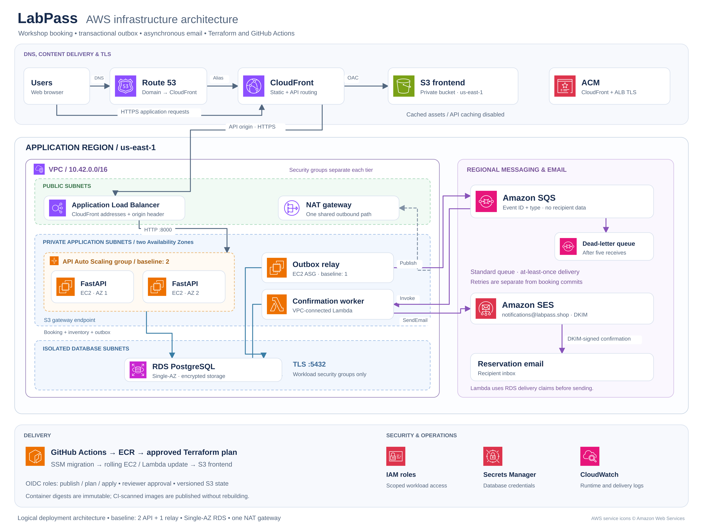

[Vector diagram](images/architecture.svg) · Service icons:
[AWS Architecture Icons](https://aws.amazon.com/architecture/icons/).

<details>
<summary>Mermaid architecture diagram</summary>

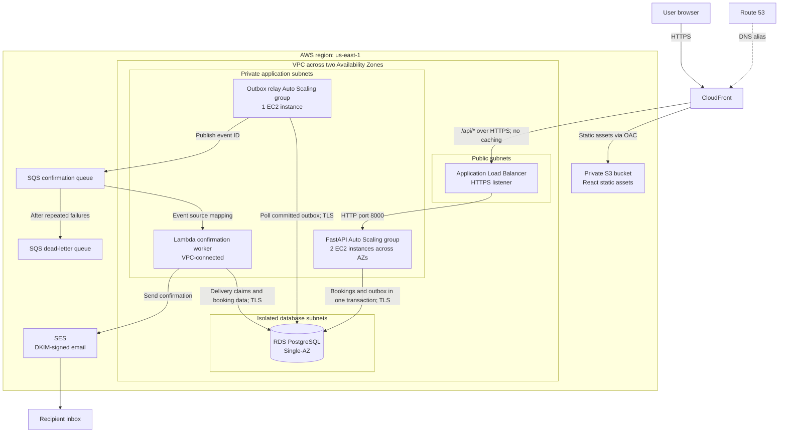

</details>

Route 53 resolves the domain to CloudFront. From there, the application has three
main paths:

| Path | What happens |
| --- | --- |
| Load the website | CloudFront fetches the React build from private S3 using Origin Access Control (OAC); React runs in the browser |
| Reserve a seat | Browser → CloudFront → Application Load Balancer (ALB) → private API instance → RDS PostgreSQL |
| Send confirmation | EC2 relay reads a committed database event → SQS queue → Lambda consumer → SES → recipient inbox |

The API commits the booking, seat count and an **outbox event**—a database record
of work to publish—in one transaction. The relay publishes that event to SQS;
Lambda loads booking data and coordinates delivery before sending email. Email
failures leave the booking valid. Retries are bounded, with a dead-letter queue
for repeatedly failing messages; an uncertain SES send can still produce duplicates.

The API has two EC2 instances across Availability Zones. The frontend runs on
S3/CloudFront, and the database is a separate managed RDS instance. RDS is Single-AZ;
both application AZs also share one NAT gateway for outbound access. API instance
replacement and rolling refreshes are configured; traffic-driven scaling is not.

Separate IAM roles and database users limit each workload's access. RDS connections
verify TLS certificates, and Systems Manager provides host access without SSH.
CloudFront-to-ALB traffic uses HTTPS and a shared origin token; the ALB alone can
reach the private API port.

The [architecture guide](docs/architecture.md) explains each component, the booking
sequence and IAM boundaries. [Module interfaces](infra/modules/README.md) describe
Terraform ownership; [application mechanics](docs/application-mechanics.md) cover
transaction, retry and authentication details.

## CI/CD

CI runs backend and browser tests, checks the API contract, validates Terraform
with mocked-provider tests, audits dependencies and scans source, infrastructure
and container images. High/critical image vulnerabilities block release.

The manual release workflow runs from `dev`:

```text
Preflight → CI → Publish scanned images → Save Terraform plan → Apply and verify
```

Publish, plan and apply use separate OIDC roles and protected GitHub environments
with reviewer approval. The pipeline publishes the images already scanned by CI
to ECR, deploys by digest and verifies the saved plan's checksum and release
metadata before applying. Apply runs database migrations through SSM, updates
existing workloads, waits for rolling instance refreshes, uploads frontend assets
and checks readiness through CloudFront. Initial infrastructure provisioning is
separate from this release workflow.

Configuration and permissions: [CI/CD and release security](docs/delivery.md).

## Stack

| Area | Technologies |
| --- | --- |
| Infrastructure | Terraform: Route 53, CloudFront, S3, VPC, ALB, EC2, ECR, SQS, RDS, IAM and Secrets Manager |
| Delivery | GitHub Actions, AWS OIDC, Trivy, Gitleaks, Bandit, dependency audits and SBOMs |
| Cloud workers | Amazon SQS, AWS Lambda, Amazon SES, Secrets Manager |
| Database | PostgreSQL 18 |
| Backend | Python 3.14, FastAPI, SQLAlchemy, Alembic |
| Frontend | React, TypeScript, Vite |
| Local environment | Docker Compose, ElasticMQ, Mailpit |

## Deployment evidence

<details>
<summary>Successful CI and AWS release</summary>

CI completes the security, backend, frontend, Terraform and image checks.

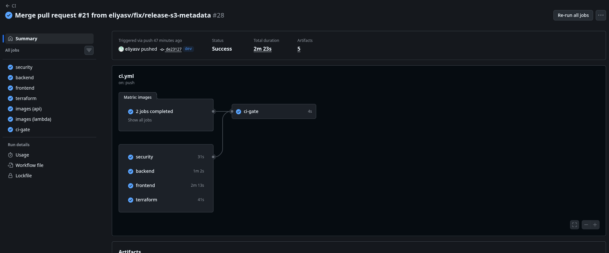

The release completes preflight, verification, image publication, plan and apply.

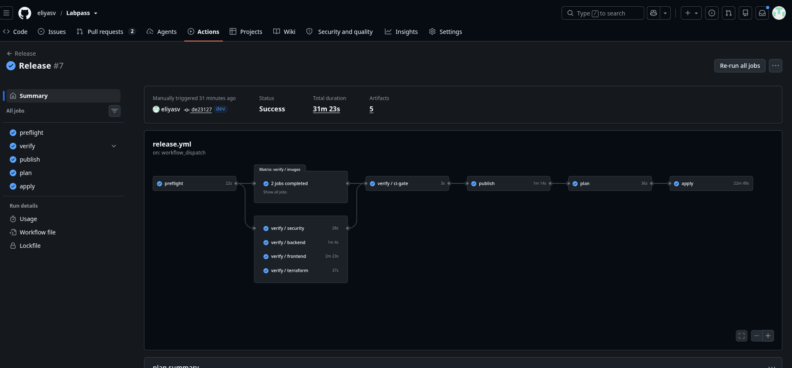

</details>

<details>
<summary>AWS networking and request routing</summary>

The VPC contains public, application and database subnets across two AZs, with a
NAT gateway and S3 gateway endpoint.

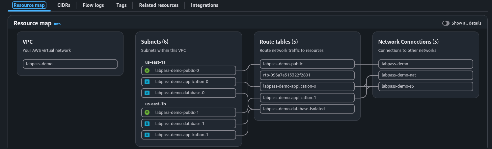

The ALB routes API requests to two healthy targets.

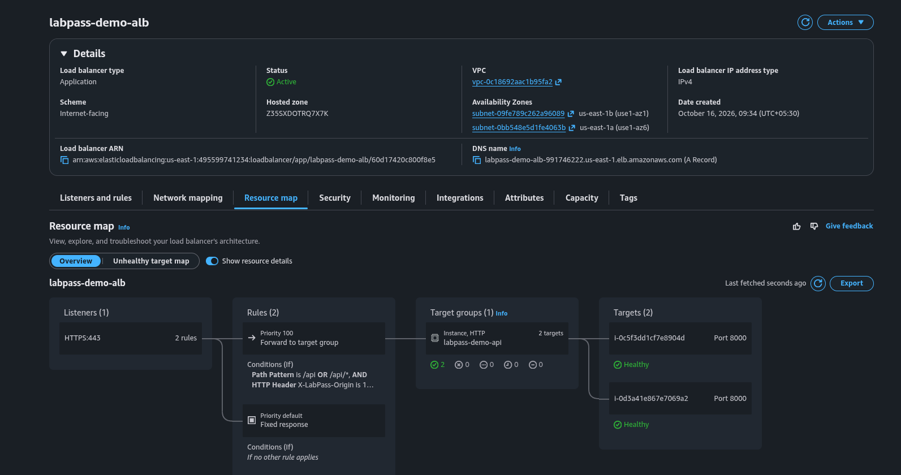

CloudFront has separate frontend and API origins; the S3 origin uses OAC.

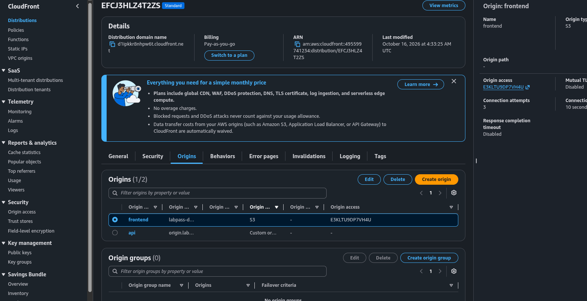

Additional views: [Auto Scaling groups](images/asg.png),
[RDS console](images/rdsconnectity.png) and
[booking cancellation](images/bookingcanceled.png).

</details>

<details>
<summary>Seat reservation and email confirmation</summary>

A reservation reduces available capacity and appears in the user's bookings.

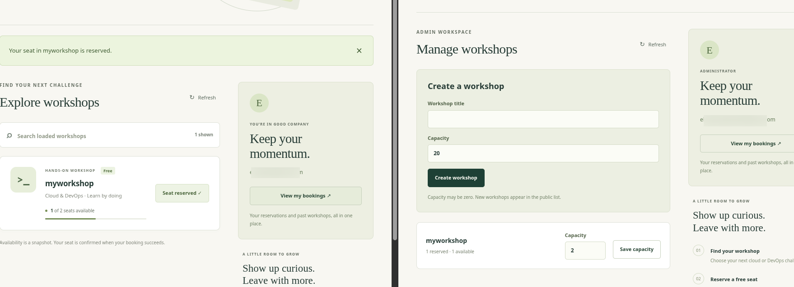

SES confirmation received from `notifications@labpass.shop`.

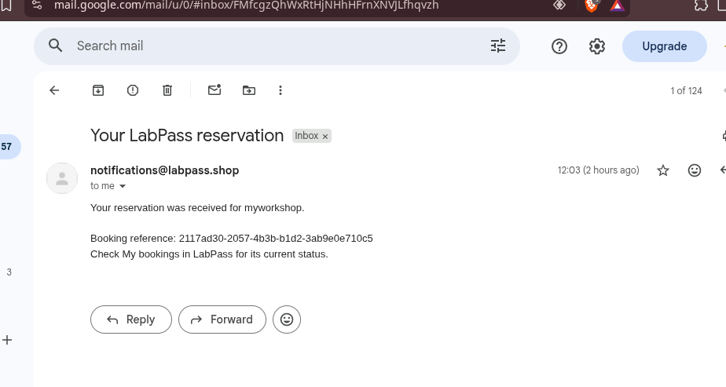

The Lambda log records `email_delivery` with outcome `sent` for the booking.

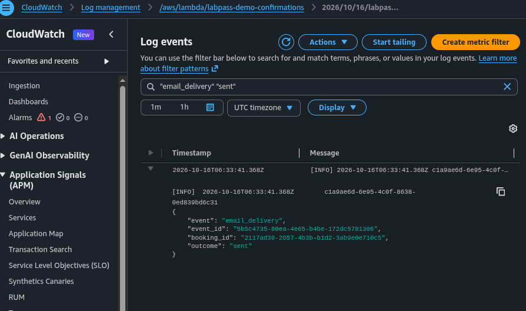

</details>

## Features

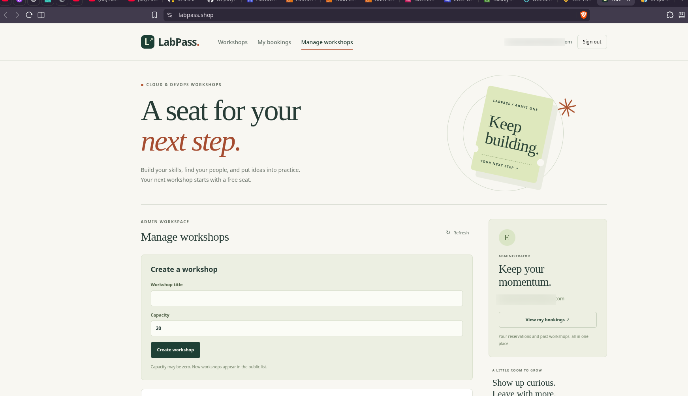

- Registration and login with password hashing and cookie sessions.
- Workshop browsing with seat availability.
- One active booking per user and workshop.
- Booking history and cancellation.
- Admin workshop creation and capacity management.
- Asynchronous confirmation emails with retries and duplicate handling.

PostgreSQL owns inventory. Booking, seat count, idempotency key and confirmation
event commit in one transaction. Concurrent requests cannot exceed capacity;
retrying a successful request with the same key returns the original booking.

## Run locally

Requires Docker Engine and the Docker Compose plugin. From the repository root:

```bash
[ -f .env ] || cp .env.example .env
docker compose up --build --wait --wait-timeout 120
docker compose exec api python -m labpass.seed
```

Compose starts the database, migrations, API, frontend and background workers.
The seed adds a sample workshop; create your own account in the app.

| Service | URL |
| --- | --- |
| LabPass | <http://127.0.0.1:8000/> |
| API docs | <http://127.0.0.1:8000/docs> |
| Captured emails | <http://127.0.0.1:8025/> |

Create an account, sign in and reserve a seat. Your reservation appears under
**My bookings**, where you can cancel it. Confirmation emails appear in Mailpit;
local development does not send mail to the internet.

To create an administrator:

```bash
docker compose exec api python -m labpass.create_admin --email operator@example.test
```

The command prompts for a password. Use an unused email, then sign in to access
**Manage workshops**.

Set `LABPASS_PORT` and `LABPASS_MAIL_PORT` in `.env` to change the local ports.
Stop the stack with `docker compose stop`; database, queue and mailbox data are
kept in named volumes.

## Testing

With the local stack running and the sample workshop seeded:

```bash
python3 scripts/smoke-local.py
docker compose exec -T consumer python < scripts/smoke-background.py
```

These checks exercise registration, login, booking, cancellation and confirmation
delivery, including duplicate handling.

Backend tests require Python 3.14 and PostgreSQL 18, with `initdb`, `pg_ctl` and
`createdb` on your PATH:

```bash
python3 -m venv .venv
.venv/bin/python -m pip install --require-hashes -r backend/requirements.lock -r backend/requirements-dev.lock
bash scripts/test-local.sh -q
```

The runner creates an isolated PostgreSQL cluster. The suite covers transactions,
migrations, authentication, worker failures and 100 users competing for 20 seats.
AWS responses are stubbed; database transactions use real PostgreSQL.

Frontend checks require Node.js 20.19+ in the 20.x line, or 22.12+, and the backend
dependencies installed above:

```bash
npm --prefix frontend ci
npm --prefix frontend run check-contract
npm --prefix frontend run build
```

See the [development guide](docs/development.md) for hot reload, browser tests,
API requests, worker recovery and dependency updates.

## Project structure

```text
backend/       FastAPI app, migrations, workers, tests and container images
frontend/      React app, generated API types and browser tests
local/         Local queue configuration
scripts/       Database test runner, smoke checks and OpenAPI export
infra/         Terraform delivery, networking, compute, database, queues and runtime access
compose.yaml   Local application stack
docs/          Architecture, development guides and verification reports
```

## Project status

Deployed and exercised on AWS: HTTPS routing, workshop management, reservations,
cancellation, confirmation email delivery and a protected GitHub Actions release.

[Features and trade-offs](docs/project-status.md#implemented) ·
[Evidence and limits](docs/verification.md) ·
[Improvement priorities](docs/project-status.md#improvement-priorities)

## Documentation

| Guide | Scope |
| --- | --- |
| [Architecture and flows](docs/architecture.md) | Component roles, page loading, booking/email sequence, releases and access boundaries |
| [Infrastructure](docs/infrastructure.md) | Subnet routing, availability, scaling limits and state ownership |
| [Engineering decisions](docs/architecture.md#engineering-decisions-and-evidence) | Design rationale, supporting tests/deployment evidence and verification boundaries |
| [CI/CD and release security](docs/delivery.md) | OIDC roles, security gates, approvals, plans, migrations and rollout |
| [Application hosting](docs/application-hosting.md) | EC2 startup, health checks, refreshes, SSM and failure investigation |
| [Terraform modules](infra/modules/README.md) | Resource ownership, interfaces and dependency boundaries |
| [Verification](docs/verification.md) | Live AWS evidence, infrastructure/security checks and operational limits |
| [Application mechanics](docs/application-mechanics.md) | Transaction boundaries, retries, delivery claims, authentication and failure handling |

[All technical guides](docs/README.md) · [Terraform commands](infra/README.md) ·
[Project status](docs/project-status.md)
