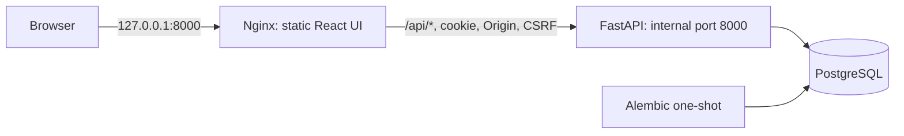

# Architecture and decisions

Deployment configuration: [Infrastructure](infrastructure.md) ·
[CI/CD and release security](delivery.md) · [Host operations](application-hosting.md).

## AWS architecture

[Vector diagram](../images/architecture.svg) ·
[Deployment evidence](verification.md#live-aws-verification).

Routing and access:

- Route 53 points the domain to CloudFront. Private S3 uses the REST origin,
  blocked public access, and an OAC bucket policy limited to the distribution;
  see [AWS OAC requirements](https://docs.aws.amazon.com/AmazonCloudFront/latest/DeveloperGuide/private-content-restricting-access-to-s3.html).
- `/api/*` targets the ALB over HTTPS with API caching disabled, all required
  methods, and explicit forwarding of authentication, idempotency and relevant
  query parameters/cookies. The
  [CachingDisabled policy](https://docs.aws.amazon.com/AmazonCloudFront/latest/DeveloperGuide/using-managed-cache-policies.html)
  has zero TTLs. API errors must not fall back to the SPA document.
- ACM viewer certificate is in `us-east-1`; the ALB certificate is in the workload
  region and matches its origin hostname. See
  [CloudFront TLS certificate requirements](https://docs.aws.amazon.com/AmazonCloudFront/latest/DeveloperGuide/cnames-and-https-requirements.html).
- The internet-facing ALB lives in public subnets, restricted to CloudFront
  origin traffic plus an origin validation header. Backend instances have no
  public IPs; their security group accepts the application port only from the
  ALB group. RDS permits PostgreSQL only from runtime and controlled migration
  security groups. RDS has no public endpoint; hosts use SSM without inbound SSH.
- Instance roles obtain ECR pull credentials and retrieve only the needed
  Secrets Manager secret at runtime. Database passwords are absent from user data,
  images, Terraform inputs/state, frontend bundles and logs. The CloudFront/ALB
  origin token is a sensitive Terraform input stored in state and service
  configuration; state and configuration access must be restricted. RDS uses verified
  TLS and separate restricted runtime and migration database roles. Instances
  use Systems Manager for operations instead of inbound SSH.
- Private instances use the NAT gateway for ECR APIs, SSM, Secrets Manager,
  CloudWatch, SQS and package retrieval. The S3 gateway endpoint provides the
  same-region S3 path, including ECR image layers. Interface endpoints are not
  configured. See [infrastructure routing](infrastructure.md#network-boundaries).

The Terraform foundation targets `us-east-1` and uses one zonal NAT plus an S3
gateway endpoint, with two application AZs and isolated database subnets.
RDS configuration is Single-AZ PostgreSQL with encrypted storage and managed
master credentials. Runtime services load separate restricted-role secrets. See
[Database runtime](database-runtime.md) and
[infrastructure design](infrastructure.md) for the current network boundaries
and [application hosting](application-hosting.md) for ALB/EC2 configuration.
Private S3, CloudFront policies, existing-zone DNS integration, certificates and
publication commands: [Frontend delivery](frontend-delivery.md).
Availability and egress trade-offs:

| Option | Cost implications | Availability and operations |
| --- | --- | --- |
| One zonal NAT gateway | One gateway's fixed cost plus traffic; possible cross-AZ transfer | Both AZs depend on one AZ's egress |
| Zonal NAT gateway per AZ | More fixed gateway cost | Each AZ keeps its own egress path |
| Interface endpoints in both AZs plus S3 gateway endpoint | Several service endpoints accrue hourly/traffic costs; not automatically cheaper than NAT | Private service paths; no general internet/package access |
| RDS Single-AZ | Lower database cost | DB remains an AZ failure point despite a two-AZ backend |
| RDS Multi-AZ DB instance | Standby and replication cost | Managed failover; standby does not serve read traffic |

See [AWS NAT designs](https://docs.aws.amazon.com/vpc/latest/userguide/nat-gateway-scenarios.html)
and [RDS Multi-AZ DB instances](https://docs.aws.amazon.com/AmazonRDS/latest/UserGuide/Concepts.MultiAZSingleStandby.html).
The selected one-NAT design has a shared egress failure point and possible
cross-AZ charges. The API tier spans two AZs; the database and shared egress each
have a single-AZ dependency. Multi-AZ database failover requires a separate
configuration change.

GitHub Actions release jobs use OIDC constrained to the repository and protected
environment. CI runs without AWS credentials and gates releases on tests and
security scans. The release workflow publishes scanned artifacts, saves a private
runtime update plan, runs one migration command, waits for fleet refreshes and
smoke-tests through CloudFront. Configuration and permissions:
[CI/CD and release security](delivery.md).
Rolling updates require backward-compatible migrations; changing stored
data can make an image rollback insufficient and require a forward fix or restore.

CloudWatch runtime logs and SES delivery metrics are configured; operational
alarms are not. Remaining work: [Project status](project-status.md).

## Engineering decisions and evidence

| Decision | Reason | Supporting evidence |
| --- | --- | --- |
| Private S3 frontend behind CloudFront | Serve a static React build without a frontend EC2 host; use one browser origin for frontend and API | [CloudFront origins](../images/cloudfront-origin.png) and deployed browser flows |
| ALB and API instances across two AZs | Distribute requests and replace unhealthy API instances | [Two healthy targets](../images/alb-resoursemap.png) and completed release refreshes |
| Separate OIDC publish, plan and apply roles | Use temporary AWS credentials and separate artifact publication from runtime changes | [IAM policies](../infra/delivery/roles.tf) and [successful release](../images/relessesucces.png) |
| Reuse scanned images and apply a verified saved plan | Preserve the artifact checked by CI and bind deployment to the reviewed plan/configuration | [Release regressions](../scripts/tests/test_release.py) cover disallowed changes, manifest mismatches and migration failure; failure injection uses stand-ins, while the normal release passed on AWS |
| Transactional outbox with SQS/Lambda email processing | Commit the booking independently of external email delivery, then retry failed work | [Worker tests](../backend/tests/test_background.py) cover publication/send failures preserving bookings; [received email](../images/labpassreservationmail.png) confirms the live path |
| PostgreSQL as the authoritative inventory store | Update capacity, booking, idempotency and outbox records atomically without coordinating separate inventory stores | [Real-database contention test](verification.md#booking-correctness-and-authentication): 100 contenders for 20 seats produce 20 bookings and 80 capacity conflicts; this measures correctness, not HTTP throughput |

Test methods, untested failure scenarios and coverage limits:
[Verification](verification.md#deployment-and-operational-limits).

## Platform choices

The explanations below connect the current platforms to the implemented workload
and operating model. Alternatives identify other viable designs, without implying
that a comparative prototype or benchmark was completed. Cost and performance
advantages have not been measured.

### EC2, Docker and systemd for the API

The API is a continuously running FastAPI process with a bounded PostgreSQL
connection pool. EC2 provides an explicit host lifecycle: launch templates define
startup, Docker runs a digest-pinned image, systemd restarts the container, and the
ALB/ASG replace unhealthy instances and coordinate rolling refreshes. SSM provides
operator access and controlled migration execution. This makes host startup,
container supervision and deployment behavior directly inspectable in the
repository. See [host operations](application-hosting.md).

The accepted cost is responsibility for AMI updates, host packages, Docker,
bootstrap failures and fleet capacity. An ASG capacity range alone does not provide
traffic-driven scaling. ECS with Fargate is an alternative if reducing host
management becomes the priority; Fargate manages the underlying compute
infrastructure, while application configuration, database limits and deployment
verification still need attention. No comparison establishes that EC2 is cheaper
or faster for LabPass. See [ECS compute options](https://aws.amazon.com/ecs/faqs/).

### EC2 for outbox polling; Lambda for queued confirmations

The two workers have different entry points. The relay continuously polls
PostgreSQL for due outbox rows; publishing to SQS happens only after a booking has
committed. Running it as a supervised EC2 process preserves a database pool across
polls and reuses the API image with a different command, IAM role and SQL role.
Its separate ASG keeps publication work outside the API request process. The
trade-off is an always-running host and a baseline of one relay; EC2 health alone
does not establish that events are being published.

The confirmation consumer processes bounded SQS batches. A
[Lambda event-source mapping](https://docs.aws.amazon.com/lambda/latest/dg/with-sqs.html)
handles queue polling and invocation, so this worker needs no separately operated
consumer host. The handler returns individual failures and records delivery claims
in PostgreSQL. Lambda adds invocation deadlines and concurrency controls that must
fit database capacity; it also uses a separate runtime image. Scheduled relay
invocations or an ECS worker service are alternatives to evaluate if polling delay,
host overhead or runtime constraints become a problem. Neither worker platform
removes the duplicate-email ambiguity after SES acceptance. See
[worker contracts](aws-workers.md).

### RDS PostgreSQL for transactional state

Capacity, bookings, idempotency records and outbox events share one PostgreSQL
transaction. Row locks and constraints enforce the booking rules without a second
inventory store. Adding DynamoDB or a cache as another authoritative store would
require a different consistency design; the current service relies on SQL joins,
foreign keys and row locks. The contention test supports this design's correctness,
but does not establish its throughput.

RDS provides the managed database host, configured backups and managed master
credentials, avoiding a separately maintained PostgreSQL EC2 host. AWS handles
underlying infrastructure and OS maintenance; schema migrations, access grants,
capacity planning and recovery verification remain project responsibilities. The
configured Single-AZ instance remains a shared failure point, and popular-workshop
writes serialize. Revisit availability through recovery requirements and scaling
through measured lock waits and connection use. See
[RDS responsibilities](https://docs.aws.amazon.com/AmazonRDS/latest/UserGuide/Welcome.html)
and [database configuration](database-runtime.md).

### Private S3 and CloudFront for the frontend

The React application builds to static files and requires no server-side rendering.
S3 stores those files behind OAC, while CloudFront routes both static and API
requests under one browser origin. This fits the cookie/Origin/CSRF contract and
avoids maintaining a frontend application host in AWS. The Nginx container remains
useful for local Compose routing.

The accepted complexity is CloudFront cache/forwarding policy, origin protection,
certificate wiring and ordered asset publication. An Nginx host is an alternative
for static delivery; a server-rendered frontend would need a runtime beyond this
static build. The current arrangement has no measured latency or cost advantage
over those alternatives. See [frontend routing and publication](frontend-delivery.md).

### Terraform and GitHub Actions for infrastructure and releases

Terraform represents resource ownership, dependencies and reviewed changes; GitHub
Actions coordinates checks, scanned artifacts, approvals and deployment. Separate
OIDC roles divide publication, planning and application. Together, they connect
the tested commit and image digests to a verified saved plan without permanent AWS
keys in CI. See [release boundaries](delivery.md#release-boundaries).

The trade-off is maintaining state, role policies, release guards and bootstrap
procedures alongside the application. Another infrastructure-as-code tool or CI
service could implement similar controls; the documented evidence establishes
this pipeline's normal release path, rather than superiority over another tool.
Revisit the tooling if its maintenance or integration requirements change.

## Failure behavior

A successful booking response follows the commit of inventory, booking,
idempotency and outbox records. Email processing happens afterward and cannot
undo that commit. The table describes behavior implied by the code and configured
infrastructure; it is not a record of injected AWS outages. Live failure and
recovery coverage remains limited as described in
[verification](verification.md#deployment-and-operational-limits).

| Failure | User-visible effect and retained state | Recovery behavior and limit |
| --- | --- | --- |
| API container or EC2 instance stops | In-flight requests can fail or lose their responses. Another healthy API target can serve requests if its dependencies remain available. Committed state and sessions are in PostgreSQL, outside the failed instance. | systemd restarts stopped containers; the API ASG uses ALB health checks for instance replacement. Startup depends on image pulls, secrets and database access. There is no measured replacement time or guarantee of uninterrupted requests. |
| RDS is unreachable or rejects connections | Workshop reads, authentication, bookings and cancellation can fail; readiness also depends on RDS. Relays and consumers cannot read authoritative events or record delivery state. Uncommitted mutations roll back; a lost commit acknowledgement leaves an uncertain result. | Processing can resume when database access returns, subject to retry limits and queue retention. The configured database is Single-AZ, with no Multi-AZ standby. Backups are configured, but restore time and recoverable data loss have not been demonstrated. |
| Shared NAT egress fails | Existing private API-to-RDS connections do not use NAT and may remain usable. AWS API calls and package retrieval using that route can fail, delaying secrets refresh, image pulls, logging and confirmations. The S3 gateway endpoint covers only its configured S3 path. | Restore the egress path before relying on new instances or expired credential caches. Both application AZs share this NAT; adding API instances does not provide independent egress. The effect on an existing process depends on which outbound calls it needs. |
| Secrets Manager retrieval fails | A process with an unexpired five-minute database credential cache may continue. When a refresh is required, the expired pool is retired and new work fails rather than falling back to expired cached credentials. | The API suppresses repeated secret calls for five seconds after an SDK retrieval error, then permits another attempt. Workers retry through their normal loop or SQS handling. Restoring access does not bypass database credential or role validation. |
| Relay stops or SQS publication fails | Bookings can still commit while confirmations wait. Unpublished events remain in PostgreSQL with retry metadata; a running or EC2-healthy relay does not prove publication progress. | The relay resumes polling after restart. Publication failures back off and stop after five committed attempts, retaining failed rows for inspection. A successful publish followed by failed bookkeeping can publish the same event ID again. Exhausted rows need operator recovery. |
| Lambda cannot process a record, or SES rejects/fails a send | The booking remains valid, but confirmation is delayed or absent. Failed records remain retryable through the configured partial-batch response. Sent/skipped delivery records suppress known duplicates. | Failed records can be received again and eventually reach the DLQ after repeated receives. Delivery claims also have a five-attempt limit. SES acceptance followed by failed database completion can still produce another email after lease expiry. Persistent failures require investigation before replay. |
| Release fails | Migration failure stops runtime rollout. Failure after apply or rollout begins can leave a partially updated fleet or frontend publication. Existing bookings are not intentionally reverted by release handling. | Inspect migration status, Terraform state, ASG template/refresh state and the Lambda alias before another release. No automatic rollback is implemented; an older image may be incompatible with the current schema or data. |

### Request errors and uncertain outcomes

The API maps handled connection, lock, pool and cloud-runtime errors to HTTP 503
with `database_unavailable_retry_same_key` and `Retry-After: 1`. Other SQLAlchemy
errors return a sanitized HTTP 500. A failure in the browser, CloudFront or ALB
may instead produce a network error or a response outside this API error format.
The browser uses a 15-second request timeout and does not automatically retry
writes. See [API error handling](../backend/labpass/app.py) and
[browser requests](../frontend/src/api.ts).

A timeout or server error does not establish whether a booking committed. The
frontend retains the same booking key for an uncertain attempt, allowing the next
explicit retry to recover the existing booking, including when inventory is now
full. A new key must not be used merely because the first response was lost.
This protection depends on retaining the attempt metadata; browser storage can
be unavailable. Cancellation retries cannot release a seat twice. Registration,
login and admin creation do not share the booking idempotency contract, so their
state must be checked before repeating an uncertain action. See
[inventory and retries](#inventory-and-retries) and
[frontend behavior](#frontend-and-local-routing).

### Detection and recovery boundaries

Liveness only establishes that the API process can respond. Readiness queries the
database and required schema; it does not check SQS publication, SES acceptance or
mailbox delivery. Relay EC2 health likewise cannot detect a stalled outbox loop.
Component logs and queue/SES metrics support investigation, but operational alarms
are not configured. Use [host failure investigation](application-hosting.md#failure-investigation)
and [confirmation inspection](confirmation-worker.md#activation-and-inspection)
to locate the failed stage.

Automatic retries are bounded. The source queue retains messages for four days
and the DLQ for fourteen days; waiting indefinitely for a dependency to recover
can lose queued work. Published outbox rows are not automatically republished
when a queue message expires. Retained database records support investigation,
but recovery must account for whether an email was already accepted and whether
its delivery state permits another attempt. A replay can duplicate an email whose
previous acceptance is uncertain. See [queue configuration](infrastructure.md#confirmation-queues).

The [reset/replay commands](development.md#worker-recovery) target local Compose.
There is no equivalent cloud recovery CLI in the AWS relay entry point. AWS
operator recovery must coordinate failed database records and SQS/DLQ messages;
its procedure and failure/redrive behavior still require deployment validation.
Release recovery limits are documented in
[delivery failure handling](delivery.md#state-plan-review-and-failure-handling).

## Application scope

FastAPI uses synchronous SQLAlchemy sessions and psycopg, with PostgreSQL as the
single authoritative store for bookings and inventory. Synchronous route handlers
run through FastAPI's worker thread mechanism. Each request gets a fresh session
and completes its transaction before returning a success response; no session
is shared between threads.
See [FastAPI dependencies](https://fastapi.tiangolo.com/tutorial/dependencies/)
and [SQLAlchemy transaction contexts](https://docs.sqlalchemy.org/en/20/orm/session_transaction.html).

Bookings are free, with one seat per booking and integer capacities including
zero. Cancellation is allowed at any time. Scheduling, expiry and waitlists are
not implemented. Workshop dates and cancellation deadlines remain deferred; the UI
uses title/capacity fields.
Registration validates email syntax and normalizes ASCII/IDNA email addresses;
email ownership and deliverability are not verified yet. `.test` addresses are
accepted for isolated local exercises, with DNS checks disabled.

## Asynchronous email

Migration `0003` adds outbox retry metadata and a durable `email_deliveries` table,
preserving existing bookings/events. Relays select due events with
`FOR UPDATE SKIP LOCKED`, lock one event per transaction, publish, then record
success. Batches stop when no event is available. The publication limit is
five committed attempts, with exponential backoff capped at 300 seconds. Failed
publication never changes the booking; exhausted rows retain a failure timestamp
and sanitized error code. A crash rolls back that attempt's bookkeeping, and a
publish-success/commit-failure can republish the same ID.

The queue envelope contains only event ID/type, without recipient or workshop
text. The consumer loads authoritative outbox/booking/user data and validates the
payload before claiming delivery. PostgreSQL claims are keyed by event ID, with
a committed attempt count, random owner token and 90-second lease. SMTP happens
outside the claim transaction. Completion/failure updates require the current,
unexpired owner token, so stale workers cannot record a newer claim's result.
Known sent/skipped duplicates are acknowledged without sending. Expired leases
are reclaimable; failed or exhausted deliveries remain for operator review.

Local Compose uses [ElasticMQ's SQS interface and persistence](https://github.com/softwaremill/elasticmq)
and [Mailpit capture](https://mailpit.axllent.org/docs/install/docker/).
The boto3 client uses an isolated SDK session with shared config/credential files
disabled, an explicit local HTTP endpoint, dummy credentials and no SDK retries.
Configuration rejects real AWS queue endpoints and external SMTP
hosts. Mailpit has no forwarding/relay configured. Only its browser UI is
published on loopback. Queue and mailbox persistence use retained named volumes.

Queue visibility is 120 seconds. Unknown failures retain this delay so a message
cannot exhaust its five-receive limit before its delivery lease expires. Poison and
terminal delivery failures use a ten-second delay and eventually redrive to the
DLQ. Queue acknowledgements use the receipt handle and happen after processing;
a delete failure causes safe reprocessing of a recorded success. See
[SQS receive semantics](https://docs.aws.amazon.com/boto3/latest/reference/services/sqs/client/receive_message.html).
Each consumer handles one message per iteration; relays handle at most five due
events. PostgreSQL coordination permits multiple instances. No in-process lock
is used to coordinate publication or delivery between workers.

Confirmations are suppressed if cancellation is observed before claiming the
send. Cancellation can still race with an in-flight send; the email says the
reservation was received and directs the recipient to current booking status.
Email failure never undoes a booking. SMTP/SES acceptance followed by failure to
record success leaves an ambiguous result: retry can send a duplicate email,
while suppressing retry can lose one if the send failed. Exactly-once email
delivery is not guaranteed by a stable Message-ID or fenced DB updates.

`process_sqs_batch` tests the partial-failure response shape. The cloud runtime
provides the Lambda entry point, relay/SQS/SES adapters, Secrets Manager refresh and
RDS TLS configuration. The Lambda consumer uses 120-second delivery leases,
source ARN validation, time admission checks and per-record failure responses.
Real PostgreSQL plus stubbed SDK responses verify transactions; the official
runtime emulator verifies offline packaging. Terraform defines an optional mapping
with `ReportBatchItemFailures`, a published-version alias and bounded concurrency.
See the [AWS worker contract](aws-workers.md) and
[Lambda partial batch responses](https://docs.aws.amazon.com/lambda/latest/dg/services-sqs-errorhandling.html).

SES identity/DKIM, configuration-set suppression/metrics, Lambda VPC permissions
and activation requirements: [Confirmation worker deployment](confirmation-worker.md).

PostgreSQL owns inventory and delivery claims. A separate inventory store would
introduce consistency requirements between two data stores. No DynamoDB table
is implemented.

## Inventory and retries

Each mutation locks the user row first, then the workshop row, then the existing
booking when cancelling. This consistent ordering avoids lock cycles between
these flows. The user lock serializes scoped keys even when two requests target
different workshops; it also serializes one user's bookings across workshops.
The workshop lock makes a transaction wait for previous reservations and then
observe the latest inventory at READ COMMITTED isolation. Read-only availability
is a snapshot, not a guarantee that a seat remains available until booking.
See [PostgreSQL row locks and deadlocks](https://www.postgresql.org/docs/18/explicit-locking.html).

A partial unique index on `(user_id, workshop_id)` for `status='active'` is the
database backstop for duplicate active bookings. Checks enforce
`0 <= reserved <= capacity`, valid statuses, and matching cancellation timestamps.
See [PostgreSQL partial unique indexes](https://www.postgresql.org/docs/18/indexes-partial.html).

The inventory counter and booking rows must be changed through the transactional
service. Bounds checks cannot enforce equality between a counter and rows in a
different table. Direct SQL that bypasses the service can corrupt that equality.
Tests assert counter/count agreement after races and rollback. Bootstrap installs
explicit runtime database grants; workers cannot write inventory and runtime roles
cannot migrate. Reconciliation monitoring remains pending.

Booking creation persists the reservation, booking, `(user, key)` record with
canonical request payload, and one `booking.confirmed.v1` outbox event in a single
commit. The key must be 8–128 characters from letters, digits, `.`, `_`, `:`, `-`.
Unknown request fields are rejected. A key reuse with a different workshop is 409.
An identical retry returns the same booking ID, reflecting its current state;
it never reactivates a cancelled booking. A new key can book after cancellation.
Failure before commit rolls everything back and does not consume the key.
If commit succeeds but the response is lost, retrying the same key finds the
committed booking. Connection/lock/pool failures return a sanitized 503 where
handled; clients should retry with the same key and bounded backoff.

Cancellation locks inventory and inspects the current status. It decrements only
on `active -> cancelled`, so retries cannot release a second seat. Capacity
updates acquire the same workshop lock and reject a value below reservations.
Lock and SQL timeouts bound database waits. The pool limits each API process's
connections; throughput for a single popular workshop is deliberately serialized.
The 100-user database test verifies correctness under contention. API throughput
has not been measured.

Alembic owns schema changes. The frozen initial migration does not import live
ORM definitions. Its downgrade removes data and is tested only in an isolated
schema; do not use it as a production rollback. A controlled migration job runs
before API startup in Compose, following
[Compose dependency conditions](https://docs.docker.com/compose/how-tos/startup-order/).
PostgreSQL 18 stores versioned data below `/var/lib/postgresql`, so the Compose
volume targets that parent as documented by the
[official PostgreSQL image](https://hub.docker.com/_/postgres).

## Authentication and browser contract

Authentication uses PostgreSQL-backed opaque sessions.
Registration creates regular users and requires 12–128 password characters,
without trimming the password. Argon2id uses random salts and explicit
argon2-cffi parameters: 64 MiB memory, three iterations and four lanes. Successful
login upgrades hashes when parameters change. Missing/locked accounts run a dummy
password verification and return the same credential error as an incorrect password.
See the [argon2-cffi API](https://argon2-cffi.readthedocs.io/en/stable/api.html).
Password operations are limited to two concurrent tasks per process to bound
memory use; overload returns 503. This is resource protection, not attempt-rate
limiting. Distributed credential-attempt throttling is not implemented.

Sessions use a fresh 32-byte random token on every login. Only its SHA-256 digest
is persisted; the raw token is delivered through an HttpOnly, host-only cookie.
Expiry is absolute at eight hours, based on the database clock. Each protected
request checks the DB session and current user role. Logging out deletes that
session; signing in rotates the current browser's session. Active sessions on
other devices remain valid. Expired sessions for a user are removed during login;
scheduled cleanup for users who never log in again is an operations task.
The design follows [OWASP session guidance](https://cheatsheetseries.owasp.org/cheatsheets/Session_Management_Cheat_Sheet.html).

Secure cookies are the default, using the `__Host-labpass_session` name, path `/`,
no Domain attribute and SameSite=Lax. Local Compose explicitly disables Secure
for loopback HTTP, using `labpass_session`. Configuration rejects insecure
cookies on a non-loopback host. The public Origin must be explicitly configured,
with HTTPS when Secure is enabled. An ALB may terminate HTTPS before private
HTTP traffic reaches the application; cookie policy does not inspect or trust
forwarded client headers. See
[Starlette responses](https://starlette.dev/responses/).

Every write requires an exact matching `Origin`, including login and registration.
Cross-site Fetch Metadata is rejected. Authenticated writes additionally require
`X-CSRF-Token`, derived with HMAC-SHA256 from the raw session cookie secret and
a fixed purpose string, and compared with `compare_digest`. Login and
`GET /api/auth/me` return this CSRF token so a page reload can restore it; the raw
session token is never in JSON. The frontend keeps the CSRF value in
memory and uses same-origin requests. See
[OWASP CSRF defenses](https://cheatsheetseries.owasp.org/cheatsheets/Cross-Site_Request_Forgery_Prevention_Cheat_Sheet.html)
and [Python HMAC](https://docs.python.org/3.14/library/hmac.html).
No permissive CORS policy is enabled. API responses include `Cache-Control: no-store`.

## Authentication transaction and migration limits

Authentication and mutation use separate short transactions. A request already
authenticated when logout commits may still finish; later requests fail session
lookup. Login commits before issuing a cookie; logout commits before expiring
the cookie. Failure before commit keeps the previous state available for retry.
If login commits but its response is lost, an unused session may remain until
expiry; a repeated login issues another fresh session. Tokens are not reused.
Validation errors omit submitted inputs, and logs omit credentials, cookies,
CSRF tokens and email addresses.

Migration `0002` adds a nullable password hash and session table, preserving legacy
users, bookings, counters, keys and outbox records. Legacy fixture users remain
locked; activation/password recovery is not implemented. Create a new administrator
with an unused email via the operator CLI, which prompts for a password and
refuses to reset or promote an existing account. A unique `lower(email)` index
prevents case-only duplicates. Existing case-only conflicts abort the transactional
migration for operator resolution; accounts are never silently merged. This
downgrade removes credentials/sessions and must not be used as a deployment rollback.

## Frontend and local routing

React/TypeScript/Vite provides a static production build, served by a
non-root Nginx container. Only the web container publishes the loopback port;
`/api/*` passes to the internal FastAPI service without path or Origin rewriting,
caching or upstream retries. Existing API clients and Swagger URLs keep working.
Nginx resolves the API name through Docker DNS so a recreated API container can
be found after DNS refresh. Compose waits for migrations, API health and web health.
See [Nginx proxy semantics](https://nginx.org/en/docs/http/ngx_http_proxy_module.html).

The frontend restores its session with `/api/auth/me` on startup. Request timeout
is 15 seconds; writes are never automatically retried. Login, registration and
admin creation can have an uncertain outcome after response loss. Booking retries
use the same UUID key, held in memory and tab session storage under the user and
workshop IDs. No credentials or auth/CSRF tokens are stored there. Successful
booking/cancellation retires that attempt; the next explicit reservation uses a
new key. A pending retry stays possible even if a refreshed inventory snapshot
is full. This lets the server recover an already-committed booking before checking
capacity. Reloading loses retry metadata if browser storage is unavailable.

Auth changes invalidate outstanding data updates and clear previous-user history;
effect cleanup ignores aborted/stale results. See [React effect cleanup](https://react.dev/reference/react/useEffect).
The UI displays safe text, explicit loading/empty/error states and request
references, asks before cancellation, and uses the server for authorization and
inventory decisions. Lists load 50 rows per page; search applies to loaded rows.
Offset pagination is a snapshot, not a stable cursor across concurrent inserts.
The UI cannot infer all active reservations from only one history page; the DB
continues to enforce one active booking per user/workshop.

TypeScript response/input types are generated from the actual FastAPI OpenAPI
schema. A contract check compares that schema with the exported snapshot and
regenerates declarations in memory to detect drift. Types are compile-time checks,
not runtime JSON validation. See [OpenAPI TypeScript API](https://openapi-ts.dev/node).
The npm lock includes package integrity hashes. Python locks contain artifact
hashes; release base images use pinned digests. CI audits dependencies and scans
release images before publication. See [Delivery](delivery.md).

Vite development proxies same-origin requests and preserves Origin. The native
backend must explicitly allow the Vite browser origin (5173); Compose uses the
web origin (8000 by default). See [Vite server configuration](https://vite.dev/config/server-options).
