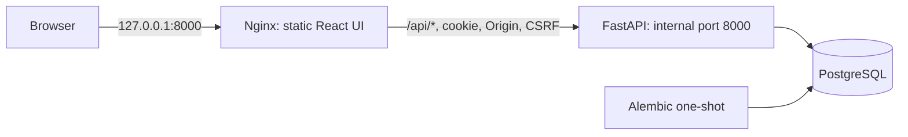
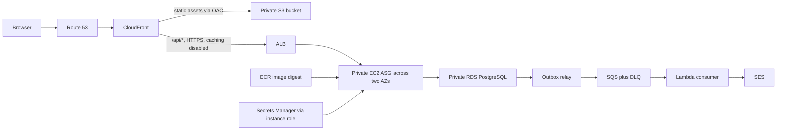

# Architecture and decisions

## Current local milestones

FastAPI uses synchronous SQLAlchemy sessions and psycopg, with PostgreSQL as the
single authoritative store for bookings and inventory. Synchronous route handlers
run through FastAPI's worker thread mechanism. This keeps the Python transaction
flow readable. Each request gets a fresh session and completes its transaction
before returning a success response; no session is shared between threads.
See [FastAPI dependencies](https://fastapi.tiangolo.com/tutorial/dependencies/)
and [SQLAlchemy transaction contexts](https://docs.sqlalchemy.org/en/20/orm/session_transaction.html).

Assumptions: free seats, one seat per booking, integer capacities including zero,
no scheduling/expiry/waitlist in milestone 1, and cancellation is allowed at any
time. Workshop dates and cancellation deadlines remain deferred; the first UI
uses existing title/capacity fields without inventing a schedule.
Registration validates email syntax and normalizes ASCII/IDNA email addresses;
email ownership and deliverability are not verified yet. `.test` addresses are
accepted for isolated local exercises, with DNS checks disabled.

## Authentication and browser contract

Milestone 2 replaces `X-User-ID` with PostgreSQL-backed opaque sessions.
Registration creates regular users and requires 12–128 password characters,
without trimming the password. Argon2id uses random salts and explicit
argon2-cffi parameters: 64 MiB memory, three iterations and four lanes. Successful
login upgrades hashes when parameters change. Missing/locked accounts run a dummy
password verification and return the same credential error as an incorrect password.
See the [argon2-cffi API](https://argon2-cffi.readthedocs.io/en/stable/api.html).
Password operations are limited to two concurrent tasks per process to bound
memory use; overload returns 503. This is resource protection, not attempt-rate
limiting. Distributed credential-attempt throttling is required before public deployment.

Sessions use a fresh 32-byte random token on every login. Only its SHA-256 digest
is persisted; the raw token is delivered through an HttpOnly, host-only cookie.
Expiry is absolute at eight hours, based on the database clock. Each protected
request checks the DB session and current user role. Logging out deletes that
session; signing in rotates the current browser's session. Active sessions on
other devices remain valid. Expired sessions for a user are removed during login;
scheduled cleanup for users who never log in again is an operations task.
The design follows [OWASP session guidance](https://cheatsheetseries.owasp.org/cheatsheets/Session_Management_Cheat_Sheet.html).

Secure cookies are the default, using the `__Host-labpass_session` name, path `/`,
no Domain attribute and SameSite=Lax. Local Compose explicitly disables Secure
for loopback HTTP, using `labpass_session`. Configuration rejects insecure
cookies on a non-loopback host. The public Origin must be explicitly configured,
with HTTPS when Secure is enabled. An ALB may terminate HTTPS before private
HTTP traffic reaches the application; cookie policy does not inspect or trust
forwarded client headers. Cookie APIs were checked against
[Starlette responses](https://starlette.dev/responses/).

Every write requires an exact matching `Origin`, including login and registration.
Cross-site Fetch Metadata is rejected. Authenticated writes additionally require
`X-CSRF-Token`, derived with HMAC-SHA256 from the raw session cookie secret and
a fixed purpose string, and compared with `compare_digest`. Login and
`GET /api/auth/me` return this CSRF token so a page reload can restore it; the raw
session token is never in JSON. The frontend keeps the CSRF value in
memory and use same-origin requests. See
[OWASP CSRF defenses](https://cheatsheetseries.owasp.org/cheatsheets/Cross-Site_Request_Forgery_Prevention_Cheat_Sheet.html)
and [Python HMAC](https://docs.python.org/3.14/library/hmac.html).
No permissive CORS policy is enabled. API responses include `Cache-Control: no-store`.

## Frontend and local routing

Milestone 3 uses React/TypeScript/Vite and a static production build, served by a
non-root Nginx container. Only the web container publishes the loopback port;
`/api/*` passes to the internal FastAPI service without path or Origin rewriting,
caching or upstream retries. Existing API clients and Swagger URLs keep working.
Nginx resolves the API name through Docker DNS so a recreated API container can
be found after DNS refresh. Compose waits for migrations, API health and web health.
See [Nginx proxy semantics](https://nginx.org/en/docs/http/ngx_http_proxy_module.html).

The frontend restores its session with `/api/auth/me` on startup. Request timeout
is 15 seconds; writes are never automatically retried. Login, registration and
admin creation can have an uncertain outcome after response loss. Booking retries
use the same UUID key, held in memory and tab session storage under the user and
workshop IDs. No credentials or auth/CSRF tokens are stored there. Successful
booking/cancellation retires that attempt; the next explicit reservation uses a
new key. A pending retry stays possible even if a refreshed inventory snapshot
is full. This lets the server recover an already-committed booking before checking
capacity. Reloading loses retry metadata if browser storage is unavailable.

Auth changes invalidate outstanding data updates and clear previous-user history;
effect cleanup ignores aborted/stale results. See [React effect cleanup](https://react.dev/reference/react/useEffect).
The UI displays safe text, explicit loading/empty/error states and request
references, asks before cancellation, and uses the server for authorization and
inventory decisions. Lists load 50 rows per page; search applies to loaded rows.
Offset pagination is a snapshot, not a stable cursor across concurrent inserts.
The UI cannot infer all active reservations from only one history page; the DB
continues to enforce one active booking per user/workshop.

TypeScript response/input types are generated from the actual FastAPI OpenAPI
schema. A contract check compares that schema with the exported snapshot and
regenerates declarations in memory to detect drift. Types are compile-time checks,
not runtime JSON validation. See [OpenAPI TypeScript API](https://openapi-ts.dev/node).
The npm lock includes package integrity hashes; Python artifact hashes and base
image digest pinning remain future delivery work.

Vite development proxies same-origin requests and preserves Origin. The native
backend must explicitly allow the Vite browser origin (5173); Compose uses the
web origin (8000 by default). See [Vite server configuration](https://vite.dev/config/server-options).

## Authentication transaction and migration limits

Authentication and mutation use separate short transactions. A request already
authenticated when logout commits may still finish; later requests fail session
lookup. Login commits before issuing a cookie; logout commits before expiring
the cookie. Failure before commit keeps the previous state available for retry.
If login commits but its response is lost, an unused session may remain until
expiry; a repeated login issues another fresh session. Tokens are not reused.
Validation errors omit submitted inputs, and logs omit credentials, cookies,
CSRF tokens and email addresses.

Migration `0002` adds a nullable password hash and session table, preserving legacy
users, bookings, counters, keys and outbox records. Legacy fixture users remain
locked; activation/password recovery is not implemented. Create a new administrator
with an unused email via the operator CLI, which prompts for a password and
refuses to reset or promote an existing account. A unique `lower(email)` index
prevents case-only duplicates. Existing case-only conflicts abort the transactional
migration for operator resolution; accounts are never silently merged. This
downgrade removes credentials/sessions and must not be used as a deployment rollback.

## Inventory and retries

Each mutation locks the user row first, then the workshop row, then the existing
booking when cancelling. This consistent ordering avoids lock cycles between
these flows. The user lock serializes scoped keys even when two requests target
different workshops; it also serializes one user's bookings across workshops.
The workshop lock makes a transaction wait for previous reservations and then
observe the latest inventory at READ COMMITTED isolation. Read-only availability
is a snapshot, not a guarantee that a seat remains available until booking.
See [PostgreSQL row locks and deadlocks](https://www.postgresql.org/docs/18/explicit-locking.html).

A partial unique index on `(user_id, workshop_id)` for `status='active'` is the
database backstop for duplicate active bookings. Checks enforce
`0 <= reserved <= capacity`, valid statuses, and matching cancellation timestamps.
See [PostgreSQL partial unique indexes](https://www.postgresql.org/docs/18/indexes-partial.html).

The inventory counter and booking rows must be changed through the transactional
service. Bounds checks cannot enforce equality between a counter and rows in a
different table. Direct SQL that bypasses the service can corrupt that equality;
production will separate migration/admin privileges from the runtime DB role.
Tests assert counter/count agreement after races and rollback, and the planned
operations milestone will add reconciliation checks and alerts.

Booking creation persists the reservation, booking, `(user, key)` record with
canonical request payload, and one `booking.confirmed.v1` outbox event in a single
commit. The key must be 8–128 characters from letters, digits, `.`, `_`, `:`, `-`.
Unknown request fields are rejected. A key reuse with a different workshop is 409.
An identical retry returns the same booking ID, reflecting its current state;
it never reactivates a cancelled booking. A new key can book after cancellation.
Failure before commit rolls everything back and does not consume the key.
If commit succeeds but the response is lost, retrying the same key finds the
committed booking. Connection/lock/pool failures return a sanitized 503 where
handled; clients should retry with the same key and bounded backoff.

Cancellation locks inventory and inspects the current status. It decrements only
on `active -> cancelled`, so retries cannot release a second seat. Capacity
updates acquire the same workshop lock and reject a value below reservations.
Lock and SQL timeouts bound database waits. The pool limits each API process's
connections; throughput for a single popular workshop is deliberately serialized.
The 100-user database test is a correctness test, not an HTTP throughput benchmark.

Alembic owns schema changes. The frozen initial migration does not import live
ORM definitions. Its downgrade removes data and is tested only in an isolated
schema; do not use it as a production rollback. A controlled migration job runs
before API startup in Compose, following
[Compose dependency conditions](https://docs.docker.com/compose/how-tos/startup-order/).
PostgreSQL 18 stores versioned data below `/var/lib/postgresql`, so the Compose
volume targets that parent as documented by the
[official PostgreSQL image](https://hub.docker.com/_/postgres).

## Asynchronous email: verified local pipeline

Migration `0003` adds outbox retry metadata and a durable `email_deliveries` table,
preserving existing bookings/events. Relays select due events with
`FOR UPDATE SKIP LOCKED`, lock one event per transaction, publish, then record
success. Batches stop when no event is available. Default publication budget is
five committed attempts, with exponential backoff capped at 300 seconds. Failed
publication never changes the booking; exhausted rows retain a failure timestamp
and sanitized error code. A crash rolls back that attempt's bookkeeping, and a
publish-success/commit-failure can republish the same ID.

The queue envelope contains only event ID/type, without recipient or workshop
text. The consumer loads authoritative outbox/booking/user data and validates the
payload before claiming delivery. PostgreSQL claims are keyed by event ID, with
a committed attempt count, random owner token and 90-second lease. SMTP happens
outside the claim transaction. Completion/failure updates require the current,
unexpired owner token, so stale workers cannot record a newer claim's result.
Known sent/skipped duplicates are acknowledged without sending. Expired leases
are reclaimable; failed or exhausted deliveries remain for operator review.

Local Compose uses [ElasticMQ's SQS interface and persistence](https://github.com/softwaremill/elasticmq)
and [Mailpit capture](https://mailpit.axllent.org/docs/install/docker/).
The boto3 client uses an isolated SDK session with shared config/credential files
disabled, an explicit local HTTP endpoint, dummy credentials and no SDK retries.
Configuration rejects real AWS queue endpoints and external SMTP
hosts. Mailpit has no forwarding/relay configured. Only its browser UI is
published on loopback. Queue and mailbox persistence use retained named volumes.

Queue visibility is 120 seconds. Unknown failures retain this delay so a message
cannot burn its five-receive budget before its delivery lease expires. Poison and
terminal delivery failures use a ten-second delay and eventually redrive to the
DLQ. Queue acknowledgements use the receipt handle and happen after processing;
a delete failure causes safe reprocessing of a recorded success. See
[SQS receive semantics](https://docs.aws.amazon.com/boto3/latest/reference/services/sqs/client/receive_message.html).
Each consumer handles one message per iteration; relays handle at most five due
events. PostgreSQL coordination permits multiple instances. No in-process lock
is used to coordinate publication or delivery between workers.

Confirmations are suppressed if cancellation is observed before claiming the
send. Cancellation can still race with an in-flight send; the email says the
reservation was received and directs the recipient to current booking status.
Email failure never undoes a booking. SMTP/SES acceptance followed by failure to
record success leaves an ambiguous result: retry can send a duplicate email,
while suppressing retry can lose one if the send failed. Exactly-once email
delivery is not promised, even with a stable Message-ID or fenced DB updates.

`process_sqs_batch` prepares Lambda's partial-failure response shape: only failed
records are returned for retry. The handler core is tested; an actual Lambda
entry point, SES adapter, event-source mapping (`ReportBatchItemFailures`), roles,
private DB connectivity and deployment are future work. See
[Lambda partial batch responses](https://docs.aws.amazon.com/lambda/latest/dg/services-sqs-errorhandling.html).

No DynamoDB seat-availability store is planned. Adding it now would create a
second inventory view that can lag or conflict with PostgreSQL. A future
requirement for durable consumer delivery claims could justify DynamoDB for that
nonrelational state, with PostgreSQL still owning seats. Current delivery claims
also live in PostgreSQL; no DynamoDB table exists.

## AWS target: later milestone

This is a target design, not deployed infrastructure. Planned paths:

- Route 53 points the domain to CloudFront. Private S3 uses the REST origin,
  blocked public access, and an OAC bucket policy limited to the distribution;
  see [AWS OAC requirements](https://docs.aws.amazon.com/AmazonCloudFront/latest/DeveloperGuide/private-content-restricting-access-to-s3.html).
- `/api/*` targets the ALB over HTTPS with API caching disabled, all required
  methods, and explicit forwarding of authentication, idempotency and relevant
  query parameters/cookies. The
  [CachingDisabled policy](https://docs.aws.amazon.com/AmazonCloudFront/latest/DeveloperGuide/using-managed-cache-policies.html)
  has zero TTLs. API errors must not fall back to the SPA document.
- ACM viewer certificate is in `us-east-1`; the ALB certificate is in the workload
  region and matches its origin hostname. See
  [CloudFront TLS certificate requirements](https://docs.aws.amazon.com/AmazonCloudFront/latest/DeveloperGuide/cnames-and-https-requirements.html).
- An internet-facing ALB can live in public subnets, restricted to CloudFront
  origin traffic plus an origin validation header. Backend instances have no
  public IPs; their security group accepts the application port only from the
  ALB group. RDS permits PostgreSQL only from runtime and controlled migration
  security groups. No public DB endpoint or SSH access is planned.
- Instance roles obtain ECR pull credentials and retrieve only the needed
  Secrets Manager secret at runtime. Secrets never appear in user data, images,
  Terraform plaintext inputs/state, frontend bundles or logs. RDS uses verified
  TLS and separate restricted runtime and migration database roles. Instances
  use Systems Manager for operations instead of inbound SSH.
- Private instances require a deliberate outbound path for ECR API, image
  layers, SSM, Secrets Manager, logs, and SQS for the relay. ECR PrivateLink
  requires API/DKR interface endpoints and S3 access for layers, as described in
  [ECR endpoint documentation](https://docs.aws.amazon.com/AmazonECR/latest/userguide/vpc-endpoints.html).
  SSM endpoints depend on the agent and region; verify them against
  [Systems Manager endpoint requirements](https://docs.aws.amazon.com/systems-manager/latest/userguide/setup-create-vpc.html).
  Bootstrap/package retrieval also needs network access or a prepared AMI.

Connectivity and availability selection is deferred until the infrastructure
milestone, with region-specific pricing checked then. Options to compare first:

| Option | Cost implications | Availability and operations |
| --- | --- | --- |
| One zonal NAT gateway | One gateway's fixed cost plus traffic; possible cross-AZ transfer | Both AZs depend on one AZ's egress |
| Zonal NAT gateway per AZ | More fixed gateway cost | Each AZ keeps its own egress path |
| Interface endpoints in both AZs plus S3 gateway endpoint | Several service endpoints accrue hourly/traffic costs; not automatically cheaper than NAT | Private service paths; no general internet/package access |
| RDS Single-AZ | Lower database cost | DB remains an AZ failure point despite a two-AZ backend |
| RDS Multi-AZ DB instance | Standby and replication cost | Managed failover; standby does not serve read traffic |

See [AWS NAT designs](https://docs.aws.amazon.com/vpc/latest/userguide/nat-gateway-scenarios.html)
and [RDS Multi-AZ DB instances](https://docs.aws.amazon.com/AmazonRDS/latest/UserGuide/Concepts.MultiAZSingleStandby.html).
No NAT, endpoints, or Multi-AZ option has been selected or provisioned.

GitHub Actions will authenticate with AWS using OIDC constrained to the repository
and deployment environment. Releases will deploy ECR digests, run one migration
step, prevent stale concurrent releases, and smoke-test through CloudFront.
Backward-compatible migrations will support rolling updates; changing stored
data can make an image rollback insufficient and require a forward fix or restore.

CloudWatch work will cover booking latency/errors, healthy ALB targets, database
connections, outbox backlog, SQS age/DLQ depth and Lambda failures. Backup restore
instructions and an actual restore exercise are required before claiming
recoverability. None of these delivery or recovery paths are verified yet.
