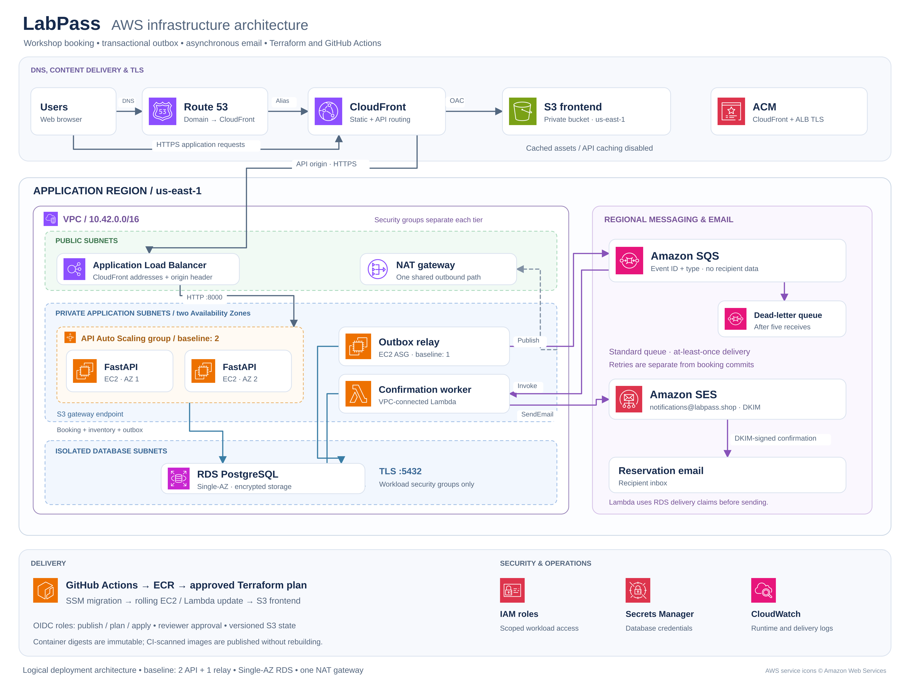

# Architecture and decisions

LabPass runs two paths: an HTTP API for workshop bookings and background workers
for confirmation emails. PostgreSQL stores bookings, sessions, seat counts and
email-processing state. The API commits a booking before email processing begins.

- [Components](#components)
- [Page loading and API requests](#page-loading-and-api-requests)
- [Booking and confirmation flow](#booking-and-confirmation-flow)
- [Releases](#releases)
- [Access and credentials](#access-and-credentials)
- [Availability and failure behavior](#availability-and-failure-behavior)
- [Engineering decisions and evidence](#engineering-decisions-and-evidence)

## AWS architecture



[Vector diagram](../images/architecture.svg) ·
[Deployment evidence](verification.md#live-aws-verification).

## Components

| Component | Responsibility | Implementation |
| --- | --- | --- |
| Route 53 | Resolves the public domain to CloudFront; DNS lookup happens before the browser connects | [Frontend DNS](../infra/modules/frontend/frontend-dns.tf) |
| CloudFront and private S3 | CloudFront serves the React build from S3 and sends API requests to the ALB | [Frontend module](../infra/modules/frontend/) |
| Application Load Balancer (ALB) | Terminates origin HTTPS, checks API readiness and distributes requests to healthy API instances | [Application networking](../infra/modules/application/application-network.tf) |
| API | Handles login, workshop management, reservations and cancellation; runs in Docker on two private EC2 instances across AZs | [API routes](../backend/labpass/app.py), [EC2/ASGs](../infra/modules/application/application-compute.tf) |
| RDS PostgreSQL | Authoritative store for users, sessions, inventory, bookings, outbox events and delivery claims; one Single-AZ database instance | [Database module](../infra/modules/database/) |
| Outbox relay | Polls committed database events and publishes them to SQS; one private EC2 instance in its own Auto Scaling group (ASG) | [Relay entry point](../backend/labpass/aws_relay.py) |
| SQS and dead-letter queue (DLQ) | Hold confirmation work for retry; the DLQ retains messages that repeatedly fail processing | [Queue configuration](../infra/foundation/services.tf) |
| Lambda confirmation consumer | Reads queued event IDs, loads booking data, claims delivery and asks SES to send the email | [Lambda handler](../backend/labpass/lambda_handler.py), [confirmation module](../infra/modules/confirmations/) |
| SES | Accepts the worker's email request and delivers mail using the verified domain | [SES configuration](../infra/modules/confirmations/confirmation-email.tf) |
| Bootstrap and migration jobs | Initialize database credentials/grants and apply schema changes using separately launched operator EC2 hosts | [Operator jobs](application-hosting.md#bootstrap-and-migration-jobs) |

The frontend has no EC2 host in AWS. RDS is a managed database, separate from the
API and relay EC2 instances. Bootstrap and migration launch templates describe
operator hosts; defining a template does not launch an instance.

## Page loading and API requests

1. Route 53 resolves the domain to CloudFront. The browser establishes HTTPS
   with CloudFront using a certificate from AWS Certificate Manager (ACM).
2. For `/` and static files, CloudFront reads the private S3 bucket using Origin
   Access Control (OAC). JavaScript and CSS under `/assets/*` use long-lived caching;
   HTML is fetched without edge caching.
3. The React code runs in the browser. Requests to `/api` and `/api/*` go to the
   same public hostname, so session cookies and browser Origin checks use one origin.
4. CloudFront forwards API requests over HTTPS to the ALB's separate origin
   hostname. It preserves cookies and required headers, disables API caching and
   adds the shared `X-LabPass-Origin` token.
5. The ALB accepts CloudFront origin-facing addresses and forwards requests only
   when the path and token match. It sends traffic to a healthy API instance on
   private HTTP port 8000.
6. The API verifies the session and write permissions, then accesses RDS over
   certificate-verified TLS. Its response returns through the ALB and CloudFront.

An **origin** is a backend CloudFront fetches from: S3 for static files and the
ALB for API requests. **Browser Origin** is the scheme, hostname and port used by the
page, checked by the API to reject writes from other sites. These are different
uses of the word. API errors retain their status/body; they are not replaced by
`index.html`.

Routing, caching, certificates and origin-token rotation:
[Frontend delivery](frontend-delivery.md). Session and CSRF details:
[Application mechanics](application-mechanics.md#authentication-and-browser-contract).

## Booking and confirmation flow

```mermaid
sequenceDiagram
    participant Browser
    participant API
    participant DB as PostgreSQL
    participant Relay as EC2 relay
    participant Queue as SQS
    participant Worker as Lambda
    participant Mail as SES
    Browser->>API: Reserve seat with session, CSRF token and booking key
    API->>DB: Lock inventory; write booking, key and outbox event
    DB-->>API: Commit transaction
    API-->>Browser: Booking confirmed
    Relay->>DB: Poll committed outbox events
    Relay->>Queue: Publish event ID and type
    Relay->>DB: Mark event published
    Queue->>Worker: Event-source mapping invokes handler
    Worker->>DB: Load booking; claim delivery
    Worker->>Mail: Send confirmation
    Mail-->>Worker: Accepted message ID
    Worker->>DB: Record sent result
    Worker-->>Queue: Report record success to mapping
```

The **outbox** is a PostgreSQL table of work to publish. A booking transaction
writes the booking, seat counter, retry key and outbox event together. All commit
or all roll back. This avoids committing a booking and losing its email event
if a separate queue call fails. The API does not call SQS or SES.
After commit, workers can run independently; the API response does not wait for them.

The **relay** bridges PostgreSQL and SQS. It selects due outbox rows, publishes
an event ID/type and records publication. The queue message contains no recipient
address or workshop text; Lambda loads those values from PostgreSQL. If publication
succeeds but the database update fails, the relay can publish the same event again.

The **consumer** is the Lambda handler. Lambda's event-source mapping polls SQS
and invokes it. Before sending, the handler records a **delivery claim**: a temporary
right to process that event, with an expiry and owner token. Recorded `sent` or
`skipped` results suppress known duplicates. The owner token prevents an expired
worker from overwriting a newer claim's result.

The mapping acknowledges successful records; reported failures become eligible
for retry after queue visibility expires. Repeatedly received failures can reach
the DLQ. If SES accepts an email but recording `sent` fails, a retry can send it
again. SES acceptance is not proof of inbox delivery. Email processing never
reverses the committed booking.

For booking retries, the browser retains the same **idempotency key**, identifying
one reservation attempt. If the response is lost after commit, retrying that key
returns the existing booking instead of taking another seat. A workshop row lock
serializes competing reservations, so the final seat cannot be allocated twice.

[Transaction and retry rules](application-mechanics.md#inventory-and-retries) ·
[AWS worker timeouts and concurrency](confirmation-worker.md#sqs-lambda-and-email-settings) ·
[Local worker recovery](development.md#worker-recovery).

## Releases

```text
Current dev commit
  → CI: test, build and scan images; build frontend
  → Publish: push those scanned images to ECR
  → Plan: save permitted runtime changes and a release manifest in private S3
  → Apply: verify plan → migrate database → apply → wait for rollout
  → Upload frontend assets, then HTML → check readiness through CloudFront
```

ECR stores container images. A **digest** identifies the exact image contents;
API/relay hosts and Lambda deploy by digest. A **saved Terraform plan** records
the proposed resource changes. Its accompanying **manifest** binds the plan to
the commit, workflow run and deployment configuration using checksums.

Publish, plan and apply each require approval through a protected GitHub
environment and use a separate temporary AWS role. The plan guard allows only
updates to existing runtime resources. Initial provisioning, IAM/network/database
configuration changes and database bootstrap require separate operator actions.

The apply job runs migrations on the private migration host through Systems
Manager (SSM) before changing the fleet. Updated launch-template versions trigger
rolling EC2 replacement. The job waits for healthy instances and completed
refreshes, checks Lambda's `live` alias, then publishes the frontend. Old and new
API instances can overlap, so schema changes must remain compatible with both.
There is no automatic rollback.

[Release configuration, permissions and failure handling](delivery.md).

## Access and credentials

Three separate controls apply to a database connection:

1. **Security groups** permit the network path from a workload to RDS on port 5432.
2. **IAM** lets that workload retrieve its own database credential from Secrets Manager.
3. **PostgreSQL grants** determine which tables and operations that credential can use.

IAM (Identity and Access Management) controls AWS permissions. Permission to read
a secret does not itself grant database table access.
Runtime services fetch passwords through the SDK; Terraform creates the secret
containers without storing their password values.

| Role | AWS responsibility | Database responsibility |
| --- | --- | --- |
| API | Read API secret; pull its image and write logs through host policies | Authentication and booking reads/writes; insert outbox events |
| Relay | Read relay secret; publish to the confirmation queue | Read/update outbox publication state |
| Consumer | Read consumer secret; consume SQS, send through SES and write Lambda logs | Read booking data; read/write delivery claims; no inventory writes |
| Bootstrap | Read the RDS master secret; initialize the four role secrets | Create restricted SQL roles, migrate and grant access |
| Migration | Read migration secret; pull its image and write logs | Own the application schema, run migrations and apply grants |
| Delivery publish/plan/apply | Publish images, save plans or update permitted runtime resources according to the stage | No direct database credential access; apply invokes the restricted SSM migration job |

EC2 instance profiles and the Lambda execution role supply temporary AWS
credentials. With OIDC (OpenID Connect), GitHub presents a token identifying the
repository and deployment environment; AWS exchanges it for temporary delivery
credentials when the role's trust policy matches. Database
passwords are separate credentials. The origin-verification token is also separate:
it is stored in Terraform state/plans and CloudFront/ALB configuration, so those
locations require restricted access.

[Exact SQL grants and secret handling](database-runtime.md#credentials-and-access) ·
[Runtime IAM policies](../infra/modules/database/runtime-access.tf) ·
[Delivery IAM policies](../infra/delivery/roles.tf).

## Availability and failure behavior

The API tier spans two AZs. The ALB routes to healthy targets; the API ASG replaces
unhealthy instances, while systemd restarts failed containers. ASG capacity limits
allow additional instances, but no traffic-driven scaling policy is configured.

| Failure | Effect and recovery boundary |
| --- | --- |
| One API host fails | Another healthy target can serve requests; in-flight requests may still fail. Committed state is in RDS. |
| RDS becomes unavailable | Login, bookings, API readiness and email processing depend on it. RDS is Single-AZ with no standby. |
| Shared NAT fails | Private RDS traffic stays within the VPC, but affected AWS API/image/secret calls can fail. Both application AZs share this egress path. |
| Relay or email delivery fails | Bookings remain committed. Events/messages wait or exhaust bounded retries; persistent failures need inspection and recovery. |
| Release fails after rollout starts | The fleet can be partially updated. Inspect state, migration status and rollout before another release; image rollback cannot undo schema changes. |

The readiness endpoint checks database/schema access, not email progress. Relay
EC2 health does not prove outbox publication. CloudWatch logs and SES metrics are
configured; operational alarms and tested restore/failover procedures remain gaps.

[Network boundaries and deployment limits](infrastructure.md) ·
[Detailed failure mechanics](application-mechanics.md#failure-behavior) ·
[Verified behavior and coverage limits](verification.md).

## Engineering decisions and evidence

| Decision | Reason | Supporting evidence |
| --- | --- | --- |
| Private S3 frontend behind CloudFront | Serve a static React build without a frontend EC2 host; use one browser origin for frontend and API | [CloudFront origins](../images/cloudfront-origin.png) and deployed browser flows |
| ALB and API instances across two AZs | Distribute requests and replace unhealthy API instances | [Two healthy targets](../images/alb-resoursemap.png) and completed release refreshes |
| Separate OIDC publish, plan and apply roles | Use temporary AWS credentials and separate artifact publication from runtime changes | [IAM policies](../infra/delivery/roles.tf) and [successful release](../images/relessesucces.png) |
| Reuse scanned images and apply a verified saved plan | Preserve the artifact checked by CI and bind deployment to the reviewed plan/configuration | [Release regressions](../scripts/tests/test_release.py) cover disallowed changes, manifest mismatches and migration failure; failure injection uses stand-ins, while the normal release passed on AWS |
| Transactional outbox with SQS/Lambda email processing | Commit the booking independently of external email delivery, then retry failed work | [Worker tests](../backend/tests/test_background.py) cover publication/send failures preserving bookings; [received email](../images/labpassreservationmail.png) confirms the live path |
| PostgreSQL as the authoritative inventory store | Update capacity, booking, idempotency and outbox records atomically without coordinating separate inventory stores | [Real-database contention test](verification.md#booking-correctness-and-authentication): 100 contenders for 20 seats produce 20 bookings and 80 capacity conflicts; this measures correctness, not HTTP throughput |

Test methods, untested failure scenarios and coverage limits:
[Verification](verification.md#deployment-and-operational-limits).

## Platform choices

<details>
<summary>Why EC2, Lambda, RDS, S3/CloudFront and Terraform/GitHub Actions</summary>

### EC2, Docker and systemd for the API

The API is a continuously running FastAPI process with a bounded PostgreSQL
connection pool. EC2 provides an explicit host lifecycle: launch templates define
startup, Docker runs a digest-pinned image, systemd restarts the container, and the
ALB/ASG replace unhealthy instances and coordinate rolling refreshes. SSM provides
operator access and controlled migration execution. See
[host operations](application-hosting.md).

EC2 requires maintaining AMI updates, host packages, Docker,
bootstrap failures and fleet capacity. An ASG capacity range alone does not provide
traffic-driven scaling. ECS with Fargate is an alternative if reducing host
management becomes the priority; Fargate manages the underlying compute
infrastructure, while application configuration, database limits and deployment
verification still need attention. See [ECS compute options](https://aws.amazon.com/ecs/faqs/).

### EC2 for outbox polling; Lambda for queued confirmations

The two workers have different entry points. The relay continuously polls
PostgreSQL for due outbox rows; publishing to SQS happens only after a booking has
committed. Running it as a supervised EC2 process preserves a database pool across
polls and reuses the API image with a different command, IAM role and SQL role.
Its separate ASG keeps publication work outside the API request process. The
trade-off is an always-running host and a baseline of one relay; EC2 health alone
does not establish that events are being published.

The confirmation consumer processes bounded SQS batches. A
[Lambda event-source mapping](https://docs.aws.amazon.com/lambda/latest/dg/with-sqs.html)
handles queue polling and invocation, so this worker needs no separately operated
consumer host. The handler returns individual failures and records delivery claims
in PostgreSQL. Lambda adds invocation deadlines and concurrency controls that must
fit database capacity; it also uses a separate runtime image. Scheduled relay
invocations or an ECS worker service are alternatives to evaluate if polling delay,
host overhead or runtime constraints become a problem. Neither worker platform
removes the duplicate-email ambiguity after SES acceptance. See
[worker contracts](confirmation-worker.md).

### RDS PostgreSQL for transactional state

Capacity, bookings, idempotency records and outbox events share one PostgreSQL
transaction. Row locks and constraints enforce the booking rules without a second
inventory store. Adding DynamoDB or a cache as another authoritative store would
require a different consistency design; the current service relies on SQL joins,
foreign keys and row locks. The contention test supports this design's correctness,
but does not establish its throughput.

RDS provides the managed database host, configured backups and managed master
credentials, avoiding a separately maintained PostgreSQL EC2 host. AWS handles
underlying infrastructure and OS maintenance; schema migrations, access grants,
capacity planning and recovery verification remain project responsibilities. The
configured Single-AZ instance remains a shared failure point, and popular-workshop
writes serialize. Revisit availability through recovery requirements and scaling
through measured lock waits and connection use. See
[RDS responsibilities](https://docs.aws.amazon.com/AmazonRDS/latest/UserGuide/Welcome.html)
and [database configuration](database-runtime.md).

### Private S3 and CloudFront for the frontend

The React application builds to static files and requires no server-side rendering.
S3 stores those files behind OAC, while CloudFront routes both static and API
requests under one browser origin. This fits the cookie/Origin/CSRF contract and
avoids maintaining a frontend application host in AWS. The Nginx container remains
useful for local Compose routing.

This setup requires CloudFront cache/forwarding policy, origin protection,
certificate wiring and ordered asset publication. An Nginx host is an alternative
for static delivery; a server-rendered frontend would need a runtime beyond this
static build. See [frontend routing and publication](frontend-delivery.md).

### Terraform and GitHub Actions for infrastructure and releases

Terraform represents resource ownership, dependencies and reviewed changes; GitHub
Actions coordinates checks, scanned artifacts, approvals and deployment. Separate
OIDC roles divide publication, planning and application. Together, they connect
the tested commit and image digests to a verified saved plan without permanent AWS
keys in CI. See [release boundaries](delivery.md#release-boundaries).

The trade-off is maintaining state, role policies, release guards and bootstrap
procedures alongside the application. Another infrastructure-as-code tool or CI
service could implement similar controls. Revisit the tooling if its maintenance
or integration requirements change.

The alternatives above have not been benchmarked for this workload.

</details>
